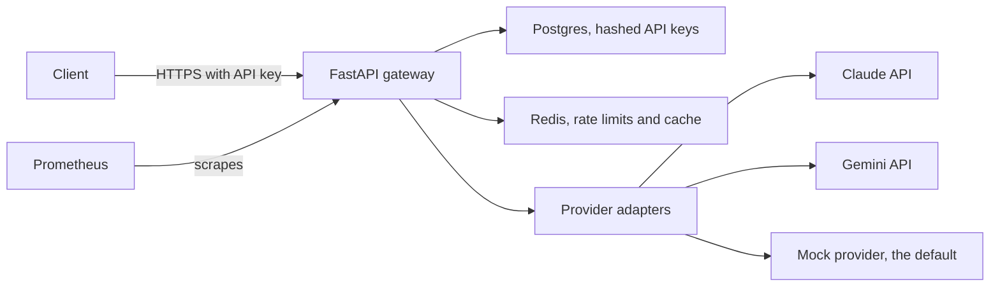
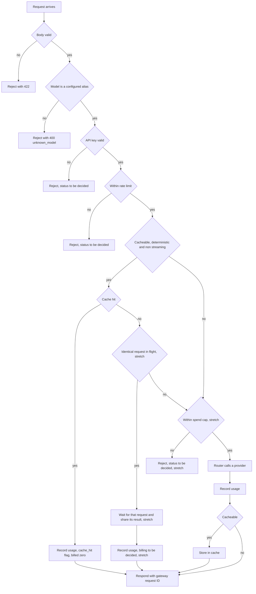
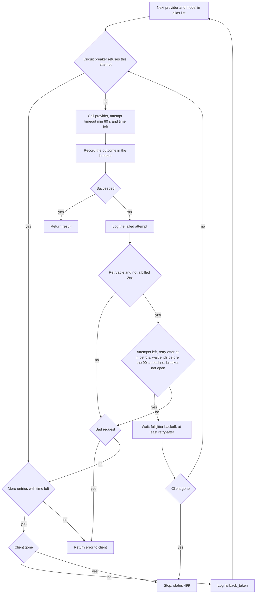
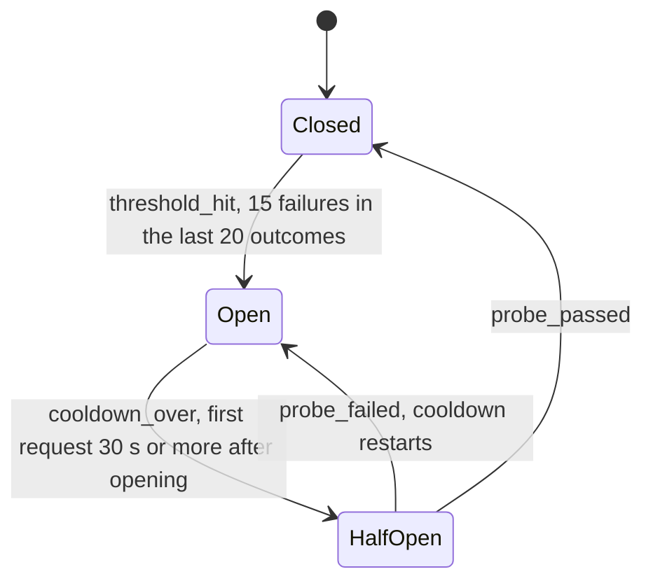
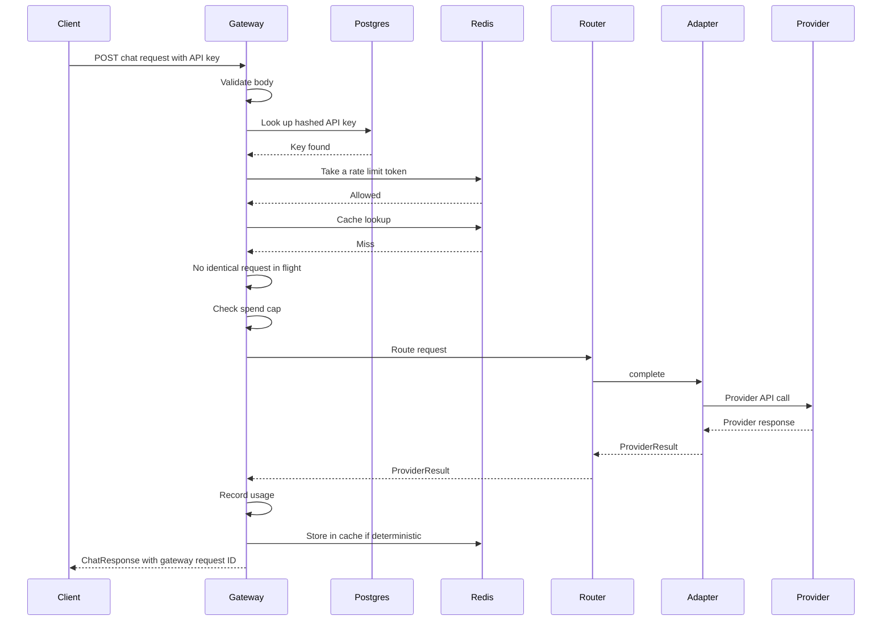

# FLOW.md

## 1. About this file

How a request moves through LLMGateway, in plain English, and how failures map to client responses.

**This file is the spec.** The diagrams show the **target design**, and the error mapping in section 13 is the contract the code must meet. Code must match this file; when a decision changes the design, the D-entry and this file change together. It does not track what is built.

## 2. Status

What is built and verified is tracked only in [PROGRESS.md](PROGRESS.md).

## 3. Big picture

Target design. The client talks only to the gateway. The gateway talks to the providers only through adapters.



Coalescing, spend caps and Prometheus metrics are stretch goals (D-031).

Where spend caps, coalescing state, and usage records live is not decided yet (see section 9).

## 4. Order of checks per request

Decided in D-018. Body validation rejects with 422 (D-019), and a `model` that is not a configured alias with 400 `unknown_model` (D-045). Which checks exist today is in [PROGRESS.md](PROGRESS.md).



Why each check sits where it does:

1. **Validate the body first.** It is the cheapest check and needs no database or Redis call. A malformed request should not cost a key lookup. Rejected with 422 (D-019). Then the `model` must exactly match a configured alias (D-045), another check that needs nothing but the config. An unknown alias gets 400 `unknown_model`, before the `stream=true` 501 and before any provider call.
2. **API key next.** Every later check is per key (rate limit, cache key, spend cap), so the gateway must know who is calling before it can apply them.
3. **Rate limit before any expensive work.** A caller over its limit should be turned away before the gateway does a cache lookup or calls a provider. Whether cache hits also count against the limit is an open question (section 11). PLAN.md measurement 5 expects 429 for this case, and D-019 reserves 429 for the gateway's own rate limiter.
4. **Cache lookup before calling anyone.** Only cacheable requests are looked up; the rest go straight to the spend cap. A hit made no upstream call, so it is returned at once and billed zero (D-012). The cache key includes the caller, so one tenant never sees another tenant's response (D-003).
5. **Coalescing after a cache miss (stretch, D-031).** If an identical request is already on its way to a provider, this one waits for that result instead of making a second upstream call. PLAN.md measurement 6 targets exactly one upstream call for N identical requests. The coalescing key is the cache key, including the caller, so tenants never share an in-flight result. Only cacheable requests coalesce.
6. **Spend cap just before spending (stretch, D-031).** This is the last point where the gateway can refuse before money is spent. Placing it after the cache and coalescing means free answers are never blocked by the cap. The rejection status is to be decided. Checking the cap before the call and recording usage after it is not atomic: concurrent requests can all pass the check before any of them records its cost. How the cap stays atomic across a provider call (for example, reserving the worst-case cost before the call and settling the real cost after) is not decided.
7. **Router.** Applies timeouts, retries, the circuit breaker, and fallback (section 5).
8. **Record usage after the call.** Real token counts are only known once the provider answers.
9. **Store in cache only if deterministic and non-streaming** (D-003). Sampled output should not be replayed as if it were the only answer.
10. **Respond with the gateway request ID** (D-011), so logs, metrics, and accounting share one key.

## 5. Router flow

The router tries the entries of the requested alias in order (D-010). Each entry is a (provider instance, provider model) pair from the config (D-044). The adapter gets a copy of the request whose `model` is the entry's provider model, and the response reports that provider model and the instance's provider type (D-045). Errors are classified by their `retryable` flag (D-014). `Router.serve` runs this for non-streaming requests; streams get the pre-first-byte rule in M12.



Retry rules for one entry (D-050 to D-052, `RetryPolicy` defaults):

- At most 3 attempts. Only a `ProviderError` with `retryable` true is retried; anything else is raised after one attempt, and the router raises the adapter's own exception object when it gives up.
- Not retried: an error whose provider `status` is 2xx, such as a malformed body, because the provider already billed that generation (D-052); a rate limit whose `retry-after` is over 5 s, which goes to the client as 503 with `Retry-After` (D-051).
- Wait after failed attempt `n`: `random() * min(2.0, 0.2 * 2 ** (n - 1))` seconds (full jitter), or `retry-after` when that is longer. No wait before the first attempt or after the last.
- Before every attempt, retries included, the router asks the breaker (D-058). Refused before the first attempt: no adapter call, and the client gets 503 `provider_circuit_open`. Refused before a retry: no further call, and the last failure is raised. If the breaker is open after a failed attempt, there is no wait and no retry, and the line says `retry=no`. `retry=yes` is the intent when the line is written: a breaker that opens during the wait still stops the retry.
- Each attempt runs under `min(60 s, time left)`; if that fires, the attempt fails with `ProviderTimeout` reason `attempt_timeout` (retryable). The whole call has a 90 s deadline: a retry whose wait would reach it is not made.
- Every attempt that fails with a `ProviderError` (including the router's own timeout) writes one `attempt_failed` line to `llmgateway.router` at WARNING with the request ID, alias, instance, provider model, attempt number, provider status, reason code, error class and whether it retries (D-054). Nothing in it reaches the client. Any other exception is a bug: it propagates at once, with no router line. Cancellation is neither: an `asyncio.CancelledError` during an attempt or a wait propagates at once, with no further attempt and no router line. A client disconnect does not cancel an attempt in flight, and the router checks for it before each retry and each fallback attempt (D-062).

Fallback rules (D-060 to D-062):

- Moves to the next entry: `ProviderTimeout`, `ProviderUnavailable` (including a billed malformed 2xx, which is not retried), `ProviderRateLimited` (including a `retry-after` over 5 s), `ProviderAuthError` and `ProviderCircuitOpen`. `router.falls_back` is the one place this lives.
- Ends the request: `ProviderBadRequest`, any other `ProviderError` subclass, a bug, and a cancellation. An empty `max_tokens` answer is a success (D-049).
- When no entry serves, the client gets the last failure that really happened. Only when every entry refused does it get 503 `provider_circuit_open`, with the smallest `Retry-After`.
- One deadline covers the whole request. A non-last entry must finish 30 s before it (`fallback_reserve`), so a hung first entry stops at 60 s and the next one has 30 s. An entry whose limit has passed is skipped.
- Attempts number from 1 for each entry, with up to 3 per entry. Each move writes one `fallback_taken` line to `llmgateway.router` at WARNING with the request ID, alias, the instance and model left and reached, the reason code and the error class.
- Before each retry, after its wait, and before each move, the router awaits `is_disconnected`. If the client has gone it raises `ClientDisconnected`: no call, no breaker check and no `fallback_taken` line, and the request line says `status=499`. There is no check before a request's first attempt.

**Streaming rule:** a streaming request can only fall back **before the first byte is sent** to the client. After that, the client has already received part of one provider's answer, and switching providers would splice two different answers together. A failure mid-stream ends the stream with an error instead.

## 6. Circuit breaker

A circuit breaker stops the gateway from repeatedly calling a provider that is failing. There is one per config instance, held in process memory (D-055). Each adapter call is an outcome, retries included (D-056), and the trip rule and values are `BreakerPolicy` defaults (D-057).



- **Closed:** the normal state. Calls go through. The window holds the last 20 success and failure outcomes; 15 failures in it open the breaker, even before it is full.
- **Open:** the provider is treated as down. Calls are not sent. The router moves straight to the next entry in the alias list, and if every entry refused, the client gets 503 `provider_circuit_open` with `Retry-After` set to the cooldown left, rounded up (D-058). This protects a struggling provider and saves the time a doomed call would take.
- **HalfOpen:** the first request at or after the cooldown is the probe, and there is one at a time; every other request is refused, with no `Retry-After`. A success closes the breaker and empties the window. A failure reopens it and restarts the full cooldown. Nothing moves the breaker with no traffic: there is no timer.

| Outcome of an adapter call | Breaker |
| --- | --- |
| A result | Success |
| `ProviderTimeout`, including the router's `attempt_timeout` | Failure |
| `ProviderUnavailable`, including a malformed 2xx | Failure |
| `ProviderAuthError`, including 402 | Failure |
| `ProviderRateLimited` | Neutral |
| `ProviderBadRequest` | Neutral |
| Any other exception, or a cancellation | Neutral |

A neutral outcome is not added to the window. On a probe it frees the slot and changes nothing, so the state stays half-open and the next request is the next probe.

An outcome counts only if the state has not changed since its call was allowed: a call that started before the breaker opened cannot close it, restart its cooldown, or stand in for the probe (D-057).

Every state change writes one line to `llmgateway.breaker` at WARNING, and nothing else does (D-059): `breaker_state_change ts=%s provider=%s from=%s to=%s reason=%s`, with `ts` in UTC to the millisecond, and `reason` the code on the diagram's arrow. None of it reaches a client. When an attempt trips the breaker, this line comes before that attempt's `attempt_failed` line.

## 7. One request, step by step (target design)

A non-streaming request that misses the cache and succeeds on the first provider.



## 8. Module map

The target layout of `src/llmgateway` and what each module owns. Names of modules not written yet may change; which modules exist is in [PROGRESS.md](PROGRESS.md).

```
src/llmgateway/
├── __init__.py          package docstring only
├── schema.py            ChatRequest, ChatResponse, Usage, stream event models
├── providers/
│   ├── __init__.py      package docstring only
│   ├── base.py          ProviderResult, ProviderAdapter, ProviderError classes
│   ├── mock.py          MockProvider
│   ├── claude.py        ClaudeAdapter, Messages API over httpx
│   └── gemini.py        GeminiAdapter, generateContent over httpx
├── app.py               create_app, request middleware, endpoints
├── errors.py            error body, status mapping, exception handlers
├── config.py            TOML config: provider instances and aliases, validated at startup
├── breaker.py           CircuitBreaker, BreakerPolicy: one per config instance
├── router.py            alias selection, timeouts, retries, breaker checks and fallback
├── main.py              module-level app for uvicorn, config from the environment
├── auth                 API key hashing and lookup
├── ratelimit            Redis Lua token bucket
├── cache                cache key and storage
├── coalescing           stretch (D-031)
├── spend                stretch (D-031): spend caps
├── accounting           usage and cost records
└── metrics              stretch (D-031): Prometheus metrics
```

## 9. What lives where (data)

| Where | What |
| --- | --- |
| Postgres | Hashed API keys, managed with SQLAlchemy and Alembic |
| Redis | Rate limit token buckets, updated by a Lua script using Redis server time (D-002) |
| Redis | Cached responses, keyed by a hash of the normalized request, model, params, and caller (D-003) |
| Process memory | Circuit breaker state, one per config instance in each worker, lost on restart (D-055) |
| To be decided | Usage and cost records; spend cap counters and coalescing state (stretch, D-031) |
| Never stored | Plaintext API keys: only hashes are kept, compared in constant time (CLAUDE.md) |
| Never logged | Prompts, response content, API keys, secrets (CLAUDE.md) |
| Never in the repo | Secrets of any kind; the repo is public (CLAUDE.md) |

## 10. Glossary

- **Adapter:** a small translator for one provider. It turns the gateway's unified request into that provider's API call, and the provider's answer or error back into the gateway's types. Everything else in the gateway only sees the unified types.
- **Token bucket:** a rate limiting method. Each key has a bucket that refills at a steady rate up to a maximum. Each request takes a token; with no tokens left, the request is turned away. It allows short bursts but caps the average rate.
- **Why Lua:** the rate limiter must read and update a bucket in one step, or two requests at the same moment could both see the last token. Redis runs a Lua script as a single uninterrupted step, so that cannot happen. Using Redis's own clock means every gateway instance agrees on the time (D-002).
- **Cache key, and why it includes the caller:** the cache key is a fingerprint of the request: its normalized content, model, parameters, and the caller's key or tenant ID. Equal requests get the same fingerprint (that is why `stop=[]` is normalized to `None`, D-013). The caller is included so one customer can never receive a response cached for another (D-003).
- **Coalescing (stretch, D-031):** when several identical requests arrive at the same time, only the first goes to the provider. The others wait and share its answer. This saves money and protects the provider during bursts.
- **Backoff and jitter:** after a failure, wait before retrying, and raise the longest possible wait after each failure (backoff). The actual wait is picked at random between zero and that limit (full jitter, D-050), so many clients that failed together do not all retry at the same instant.
- **Circuit breaker:** a switch that stops calling a provider after it keeps failing, then cautiously tries again later with one trial call, the probe. See section 6.
- **Alias:** the name a client sends in `model`, such as `fast`. The config maps it to an ordered list of (provider instance, provider model) pairs (D-010, D-044). The client never names a provider model directly.
- **Fallback:** if one provider cannot answer, try the next provider and model in the alias's list (D-010). The list is explicit, so the gateway never guesses which models are equivalent.
- **Retryable error:** an error where trying again might work, such as a timeout, a provider rate limit, or a provider outage. A bad request or a credential problem will fail the same way every time, so it is not retryable (D-014).
- **Spend cap (stretch, D-031):** a budget per API key. Once a key's recorded spend reaches its cap, further paid requests are refused. The check must be atomic so concurrent requests cannot overshoot it; PLAN.md measurement 7 targets zero overshoot.
- **Mock provider:** a fake provider built into the gateway. It answers instantly or with a set delay, fails on demand at a set rate, and gives the same answer every time, so tests are free and repeatable. Its token counts are word counts, not real tokens (D-001, D-016).

## 11. Open design questions

Listed, not answered.

- Whether cache hits count against rate limits.
- The status code returned when a spend cap rejects a request (stretch, D-031).
- Retry counts, timeouts and breaker thresholds are chosen (D-050, D-051, D-057) but not yet measured.
- How coalesced requests are billed (stretch, D-031).
- How spend caps stay atomic across a provider call (stretch, D-031).
- Whether the API key is checked before the request body is parsed, once auth exists. Parsing first lets unauthenticated callers make the gateway parse large bodies (D-018, D-025).

## 12. Keeping this file honest

- No status, dates or commit SHAs here; status lives in [PROGRESS.md](PROGRESS.md).
- Edit the target-design diagrams and the error mapping only when a decision in DECISIONS.md changes the design, and link its D-number in the affected section.
- When code and this file disagree, either the code is fixed or a new D-entry changes the spec; the spec is never edited silently to match the code.

## 13. Error mapping

Every failure an adapter sees becomes one `ProviderError` class (D-014), and `errors.py` maps that class to the client status and code (D-019). The client always gets the standard error body with a fixed message (D-023): never the provider's error text, the prompt, or the key.

Every `ProviderError` also carries `status` (the provider's HTTP status, or none when no response arrived) and `reason`, a fixed code from D-054; both columns below. They are logged for each failed attempt and never sent to the client. Retryable means trying again might work (D-014); the router still does not retry a 2xx row (D-052).

### Claude (`providers/claude.py`, D-033, D-035, D-048, D-053, D-054)

| Provider outcome | Error type | Retryable | Status, reason | Client status | Client code |
| --- | --- | --- | --- | --- | --- |
| Request sets `temperature` or `top_p` (rejected before any network call) | `ProviderBadRequest` | no | none, `local_check` | 400 | `provider_bad_request` |
| HTTP 401 or 403 | `ProviderAuthError` | no | the status, `auth` | 502 | `provider_auth_error` |
| HTTP 402 `billing_error` (D-048) | `ProviderAuthError` | no | 402, `billing` | 502 | `provider_auth_error` |
| HTTP 408 (D-053) | `ProviderUnavailable` | yes | 408, `http_status` | 502 | `provider_unavailable` |
| HTTP 429 | `ProviderRateLimited`, `retry_after_seconds` from a numeric, finite, non-negative `retry-after`, else none | yes | 429, `rate_limited` | 503, with `Retry-After` rounded up to whole seconds when known, never below 0 (D-038) | `provider_rate_limited` |
| Any other HTTP 4xx (400, 404, 409, 413, 422, ...) | `ProviderBadRequest` | no | the status, `http_status` | 400 | `provider_bad_request` |
| HTTP 5xx, including 529 `overloaded_error` | `ProviderUnavailable` | yes | the status, `http_status` | 502 | `provider_unavailable` |
| Unexpected HTTP 3xx (redirects are never followed, D-043) | `ProviderUnavailable` | yes | the status, `http_status` | 502 | `provider_unavailable` |
| httpx timeout: connect, read, write or pool (D-034) | `ProviderTimeout` | yes | none, `timeout` | 504 | `provider_timeout` |
| Any other httpx transport error: connect, read, write, protocol | `ProviderUnavailable` | yes | none, `connection` | 502 | `provider_unavailable` |
| httpx `DecodingError`: a body whose `content-encoding` cannot be decoded, on any status (D-043) | `ProviderUnavailable` | yes | none, `undecodable_body` | 502 | `provider_unavailable` |
| HTTP 2xx whose body is not JSON, or lacks a non-empty `id`, a `content` list of typed blocks (text blocks with `text`), a string `stop_reason`, or non-negative integer `usage.input_tokens` and `usage.output_tokens` | `ProviderUnavailable` (not retried by the router, D-052) | yes | the 2xx status, `malformed_body` | 502 | `provider_unavailable` |
| HTTP 2xx with a valid body | none | n/a | n/a | 200 | n/a |

On success, `stop_reason` maps to `finish_reason`: `end_turn` to `stop`, `max_tokens` to `max_tokens`, `stop_sequence` to `stop_sequence`, and every other value, including ones added later, to `other` (D-035). The adapter never retries (D-032); the error is raised once, without the httpx exception chained to it.

### Gemini (`providers/gemini.py`, D-039 to D-042, D-048, D-049, D-053, D-054)

Request (D-039, D-040): `POST https://generativelanguage.googleapis.com/v1beta/models/{model}:generateContent` with the `x-goog-api-key` header. The body has `contents`, one `{"role", "parts": [{"text"}]}` entry per message with `assistant` sent as `model`; `systemInstruction: {"parts": [{"text"}]}` only when `system` is set; and `generationConfig` with `maxOutputTokens` (the client's `max_tokens`, unchanged) and `thinkingConfig: {"thinkingLevel": "MINIMAL"}` on every request (D-049), plus `stopSequences`, `temperature` and `topP` only when set. `includeThoughts` and `thinkingBudget` are never sent.

| Provider outcome | Error type | Retryable | Status, reason | Client status | Client code |
| --- | --- | --- | --- | --- | --- |
| `model` does not fully match `[A-Za-z0-9][A-Za-z0-9._-]*` (rejected before any network call, D-042). Not reachable from a client since aliases: a config with such a Gemini model stops startup (D-046) | `ProviderBadRequest` | no | none, `local_check` | 400 | `provider_bad_request` |
| More than 5 stop sequences (rejected before any network call, D-042) | `ProviderBadRequest` | no | none, `local_check` | 400 | `provider_bad_request` |
| HTTP 401 or 403 | `ProviderAuthError` | no | the status, `auth` | 502 | `provider_auth_error` |
| HTTP 400 whose JSON body has, in the list `error.details`, an object with `@type` `type.googleapis.com/google.rpc.ErrorInfo`, `reason` `API_KEY_INVALID` and `domain` `googleapis.com` (an invalid key; message text is never read, D-048) | `ProviderAuthError` | no | 400, `API_KEY_INVALID` | 502 | `provider_auth_error` |
| HTTP 402, prepay credit depleted (D-048) | `ProviderAuthError` | no | 402, `billing` | 502 | `provider_auth_error` |
| HTTP 408 (D-053) | `ProviderUnavailable` | yes | 408, `http_status` | 502 | `provider_unavailable` |
| HTTP 429 | `ProviderRateLimited`, `retry_after_seconds` from a numeric, finite, non-negative `retry-after`, else none | yes | 429, `rate_limited` | 503, with `Retry-After` rounded up to whole seconds when known, never below 0 (D-038) | `provider_rate_limited` |
| Any other HTTP 4xx (any other 400, 404, 409, 413, 416, ...) | `ProviderBadRequest` | no | the status, `http_status` | 400 | `provider_bad_request` |
| HTTP 5xx, including 503 and 504 `deadline_exceeded` | `ProviderUnavailable` | yes | the status, `http_status` | 502 | `provider_unavailable` |
| Unexpected HTTP 3xx (redirects are never followed, D-043) | `ProviderUnavailable` | yes | the status, `http_status` | 502 | `provider_unavailable` |
| httpx timeout: connect, read, write or pool (D-034 values) | `ProviderTimeout` | yes | none, `timeout` | 504 | `provider_timeout` |
| Any other httpx transport error: connect, read, write, protocol | `ProviderUnavailable` | yes | none, `connection` | 502 | `provider_unavailable` |
| httpx `DecodingError`: a body whose `content-encoding` cannot be decoded, on any status (D-043) | `ProviderUnavailable` | yes | none, `undecodable_body` | 502 | `provider_unavailable` |
| HTTP 2xx with `promptFeedback.blockReason` present and not null (any value), with or without candidates; a `promptFeedback` that is not an object is ignored | `ProviderBadRequest` | no | the 2xx status, `prompt_blocked` | 400 | `provider_bad_request` |
| HTTP 2xx whose body is not a JSON object, or has no candidates (and no block reason), or whose first candidate lacks a string `finishReason`, or has a part whose `text` is not a string, or lacks `usageMetadata`, or has a token count that is present but not a non-negative integer, or is malformed in any other way listed in D-041 (including nesting too deep to parse, D-043) | `ProviderUnavailable` (not retried by the router, D-052) | yes | the 2xx status, `malformed_body` | 502 | `provider_unavailable` |
| HTTP 2xx with a valid body | none | n/a | n/a | 200 | n/a |

On success (D-041): the first candidate's text is the concatenation of the `text` of its parts that are not marked `"thought": true`; parts without `text` are skipped, and a candidate with no `content` or `parts` gives empty text. `finishReason` `STOP` maps to `stop`, `MAX_TOKENS` to `max_tokens`, and every other value (`SAFETY`, `RECITATION`, ..., and ones added later) to `other`; Gemini never produces `stop_sequence`. `input_tokens` is `promptTokenCount`, `output_tokens` is `candidatesTokenCount + thoughtsTokenCount`, and an absent count is 0; `output_tokens` may exceed `max_tokens` and is reported as Google sends it, never capped (D-049). A candidate with empty text and `MAX_TOKENS` (the budget went to thinking) is a success: 200, `content` "", `finish_reason` `max_tokens` (D-049). A non-empty `responseId` becomes `provider_response_id`. `temperature` and `top_p` are sent as `generationConfig.temperature` and `topP` when set (D-040). The adapter never retries (D-032); the error is raised once, without the httpx exception chained to it.

### Mock provider and router (`providers/mock.py`, `router.py`, D-016, D-050, D-054, D-058)

| Outcome | Error type | Retryable | Status, reason | Client status | Client code |
| --- | --- | --- | --- | --- | --- |
| Mock failure injection, any `failure_type`, from the config or `LLMGATEWAY_FAULTS` (D-064) | the class for that type (D-016) | per class | none, `injected` | per class | per class |
| The router's per-attempt timeout fires (`min(attempt_timeout, time left)`) | `ProviderTimeout` | yes | none, `attempt_timeout` | 504 | `provider_timeout` |
| The breaker refuses the first attempt (no adapter call) | `ProviderCircuitOpen` | yes | none, `circuit_open` | 503, with `Retry-After` set to the cooldown left, rounded up; no header during a half-open probe | `provider_circuit_open` |

### Gateway errors (`errors.py`, `app.py`)

| Outcome | Client status | Client code |
| --- | --- | --- |
| Body fails validation, or is not valid JSON (`details` holds `loc` and `msg` only); a body that is not valid UTF-8 gets 400 `http_error` instead (row below) | 422 | `validation_error` |
| `model` is not a configured alias (exact, case-sensitive match; the value is not echoed; no provider is called; checked before the `stream=true` 501, D-045) | 400 | `unknown_model` |
| Unknown route | 404 | `not_found` |
| Method not allowed | 405 | `method_not_allowed` |
| Any other HTTP exception raised by the framework (message is the standard phrase, never its detail) | its own status | `http_error` |
| `stream=true` until streaming exists (D-022) | 501 | `streaming_not_implemented` |
| The client disconnected before a retry or fallback attempt (D-062); nobody reads this response, and it shows in the request line | 499 | `client_disconnected` |
| A `ProviderError` subclass with no mapping of its own and no mapped parent | 502 | `provider_error` |
| Any other exception | 500 | `internal_error` |

Every response, including errors, carries `x-request-id` (D-020).

### Configuration errors (startup, `config.py`, `router.py`, `main.py`, D-044, D-046)

These never reach a client: the process exits at import with `llmgateway: configuration error: <message>` and no traceback, before uvicorn serves anything. The message names the environment variable or the location in the file (for example `aliases.fast[1].provider`) and the rule broken. It never contains a value from the file, the config path, or any environment value. Only a `ConfigError` gets this line: a bug during startup keeps its traceback and is not reported as a configuration error.

| Outcome | Startup |
| --- | --- |
| `LLMGATEWAY_CONFIG` unset | Built-in default: instance `mock` (type `mock`, default settings), alias `mock` = (`mock`, `mock-1`) |
| `LLMGATEWAY_PROVIDER` set, to any value including empty | Stops (the variable is no longer read) |
| `LLMGATEWAY_FAULTS` unset | No fault windows |
| `LLMGATEWAY_FAULTS` set but blank, or an entry that does not match `<instance>=<rate>` or `<instance>=<rate>@<start>+<duration>`, a rate above 1, a duration of 0, a repeated instance, an unknown instance, or an instance that is not of type `mock` (D-064) | Stops; the message names the variable, the entry's position and the rule |
| `LLMGATEWAY_CONFIG` set but empty or blank | Stops |
| The file cannot be read, is not valid UTF-8, or is not valid TOML | Stops |
| A top-level key other than `providers` and `aliases`, or either table missing or empty | Stops |
| A provider or alias name that does not fully match `[A-Za-z0-9][A-Za-z0-9._-]*`, or is longer than 128 characters | Stops |
| A provider instance without a valid `type` (`mock`, `claude`, `gemini`), or with a key its type does not take | Stops |
| A mock setting with the wrong type or out of range: `latency_ms` a finite number >= 0; `failure_rate` a number from 0 to 1; `failure_type` one of `timeout`, `rate_limited`, `unavailable`, `bad_request`, `auth`; `seed` an integer. A TOML boolean is not a number; `inf` and `nan` are rejected | Stops |
| An alias whose value is not a non-empty array of `{provider, model}` tables, or an entry with another key | Stops |
| An entry whose `provider` names no defined instance | Stops |
| A defined instance that no alias uses | Stops |
| One alias listing the same (instance, model) pair twice | Stops |
| A `model` that is empty or longer than 128 characters | Stops |
| A Gemini entry whose `model` does not fully match the D-042 pattern (D-046) | Stops |
| An instance of type `claude` and `ANTHROPIC_API_KEY` unset or blank; type `gemini` and `GEMINI_API_KEY` unset or blank | Stops |
| Valid config | One adapter per instance; mock settings are passed to that instance's `MockProvider` |
