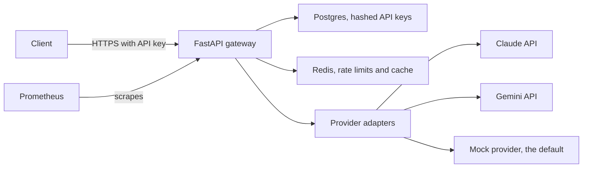
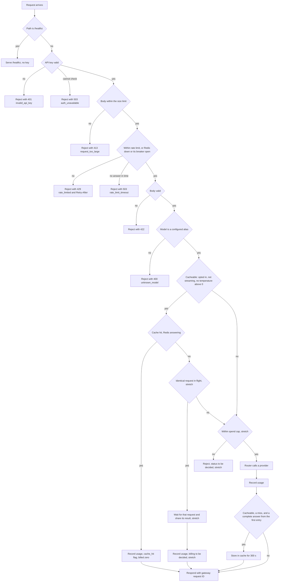
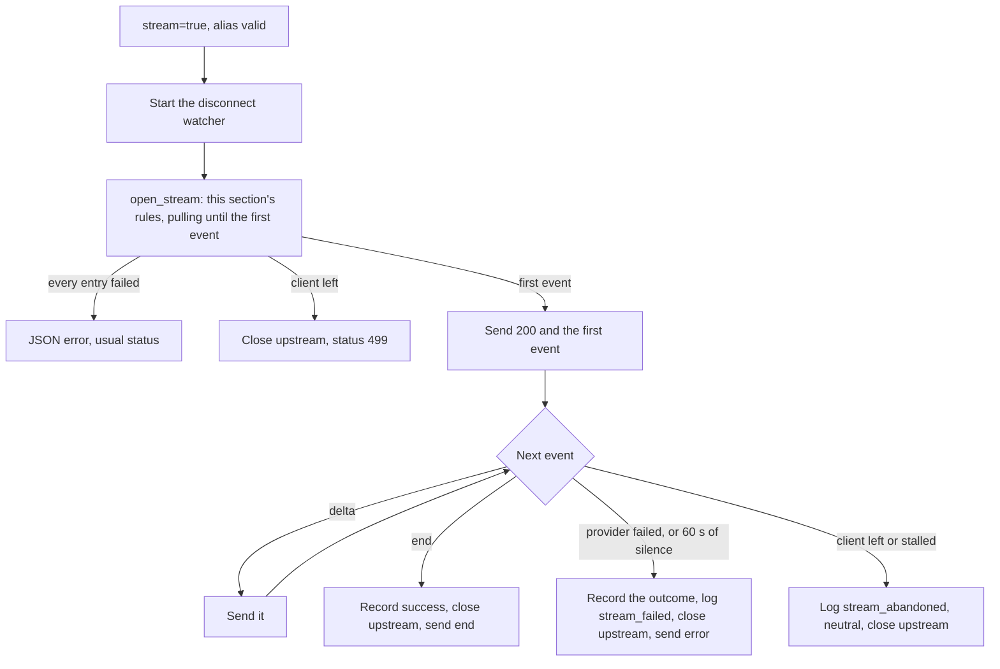
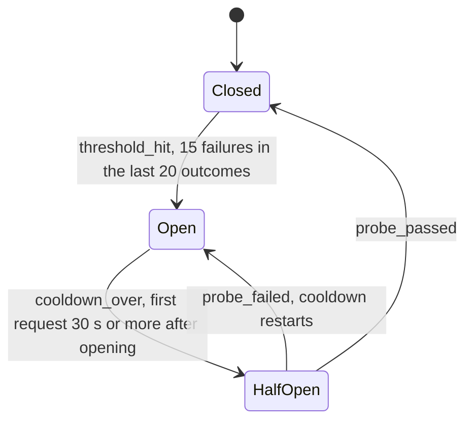
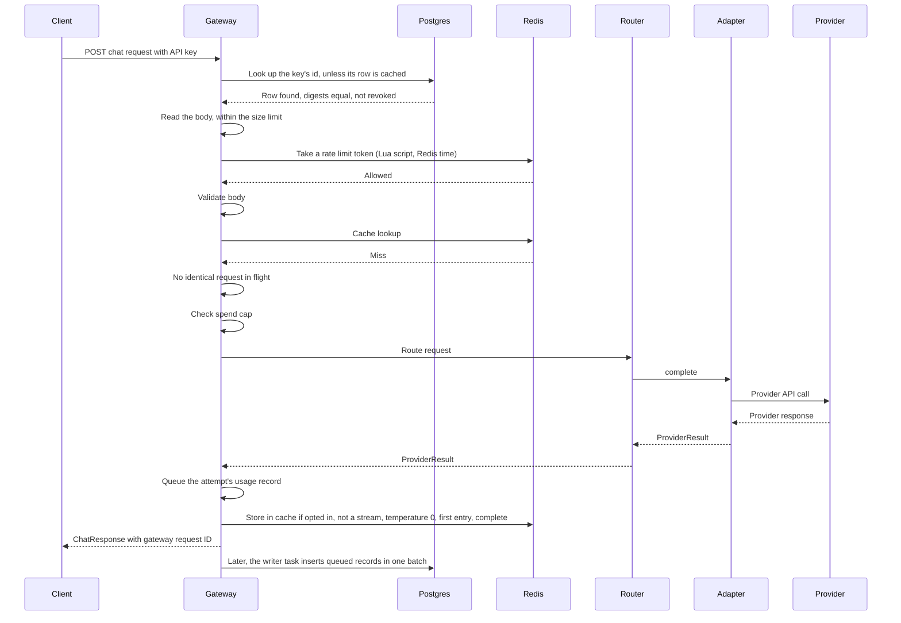

# FLOW.md

## 1. About this file

How a request moves through LLMGateway, in plain English, and how failures map to client responses.

**This file is the spec.** The diagrams show the **target design**, and the error mapping in section 13 is the contract the code must meet. Code must match this file; when a decision changes the design, the D-entry and this file change together. It does not track what is built.

## 2. Status

What is built is summarized in [README.md](README.md). The owner's progress log, with each milestone's evidence, is kept in a local `notes/PROGRESS.md` that is not in the repo.

## 3. Big picture

Target design. The client talks only to the gateway. The gateway talks to the providers only through adapters.



Coalescing, spend caps and Prometheus metrics are stretch goals (D-031).

Usage records live in Postgres (D-099). Where spend caps and coalescing state live is not decided yet (see section 9).

## 4. Order of checks per request

Decided in D-018, with the API key moved first by D-089, and the body size limit and the rate limit placed next by D-108. A missing or bad key is rejected with 401 `invalid_api_key`, and a key that cannot be checked with 503 `auth_unavailable` (D-091), before the body is read. A body over the size limit is rejected with 413 `request_too_large`, and a key over its rate limit with 429 `rate_limited`, both before the body is parsed (D-107, D-108). Body validation rejects with 422 (D-019), and a `model` that is not a configured alias with 400 `unknown_model` (D-045). Which checks exist today is in [docs/USAGE.md](docs/USAGE.md#request-lifecycle).



Why each check sits where it does:

1. **API key first, before the body is read (D-089).** Every request except `/healthz` must carry exactly one `Authorization: Bearer <key>` header with a well-formed key (D-086). The gateway reads the row for the key's id from Postgres, or from its per-process cache of found rows (D-090), compares SHA-256 digests in constant time (D-087, D-088), and refuses a revoked key. A missing, malformed, unknown, wrong or revoked key gets the same 401 `invalid_api_key` with `WWW-Authenticate: Bearer`. If the row is not cached and Postgres does not answer within 2 s or fails, the request gets 503 `auth_unavailable` and is not served; a row still in the cache is used as usual (D-091). Checking first means an unauthenticated caller cannot make the gateway parse a body or probe alias names. Every later check is per key or tenant (rate limit, cache key, spend cap), and the verified key travels on as `request.state.principal`, its key id and tenant (D-092).
2. **Body size next, before the body is parsed (D-108).** One `Content-Length` header over `LLMGATEWAY_MAX_BODY_BYTES` (default 1 MiB) is refused at once, without reading a byte; otherwise, a chunked body included, the gateway reads the body itself, counting bytes, and refuses as soon as it passes the limit. The refusal is 413 `request_too_large` with `Connection: close`. A body within the limit is handed on whole. So a key holder cannot make the gateway buffer or parse an unbounded body, and an oversized request costs no Redis call and no token.
3. **Rate limit before any parsing or expensive work (D-103 to D-107).** Each request takes one token from its key's bucket in Redis, through one Lua script that reads Redis's own clock, so the check and the update are one atomic step shared by every worker and instance. Every request that gets this far counts: a malformed body, an unknown alias and a cache hit too. A key over its limit gets 429 `rate_limited` with `Retry-After`, the seconds until its bucket holds a token; nothing after this point runs, so it reaches no provider, is not recorded and is neutral for the breaker. A connection the server closed, as a Redis restart leaves in the pool, is retried once on a new connection, inside the same budget; a timeout is never retried, and a refused connection costs two quick attempts where refusal is immediate, as on Linux; on Windows a refused connect waits out the 1 s connect timeout, which is not retried (D-106, fourth amendment). If Redis fails at once (connection refused or lost, a script error, an unusable reply), the request is allowed, with one `ratelimit_unavailable` line: the limiter fails open, unlike auth (D-106). If Redis does not answer within 1 s, the request is shed with 503 `rate_limit_timeout` and `Retry-After: 1`, never let through unlimited, so an overloaded gateway keeps its limit. The limiter has its own circuit breaker (section 6): five failures in a row open it, and while it is open the request goes on at once, without asking Redis. A timeout counts as a failure only if no other take succeeded during its wait, so a busy gateway with a healthy Redis does not open it. The pool's 50 connections are opened and the script loaded at startup, so a first burst does not spend its budget connecting (D-106, amended before M17).
4. **Validate the body next.** It needs no database or Redis call. Rejected with 422 (D-019). Then the `model` must exactly match a configured alias (D-045), another check that needs nothing but the config. An unknown alias gets 400 `unknown_model`, for a stream too, before any provider call.
5. **Cache lookup before calling anyone (D-110 to D-116).** Only cacheable requests are looked up; the rest go straight to the spend cap. Cacheable means the client sent exactly one `x-gateway-cache: use` header, the request is not a stream, and `temperature` is unset or 0: no request field can promise a deterministic answer (Claude refuses `temperature`, Gemini 3.6 ignores it), so the client says when a stored answer is acceptable (D-111). The key is the SHA-256 of a canonical JSON document holding the tenant, the alias, the alias's resolved entries and every request field but `stream`, so one tenant is never served another's answer and a hit's speed never tells one tenant what another asked (D-110). A hit made no upstream call: it is returned at once with a new gateway `id`, recorded as one usage row with `cache_hit` true and cost 0, and it has already counted against the rate limit (D-113). If Redis cannot answer within 250 ms, fails, or the cache's own breaker is open, the request goes on as if not cacheable, with one `cache_unavailable` line; the cache never fails a request (D-114). Every 200 says `x-gateway-cache: hit`, `miss` or `bypass` (D-116).
6. **Coalescing after a cache miss (stretch, D-031).** Not built: today identical concurrent misses each call the provider, are each billed, and the last to finish is stored (D-115). If an identical request is already on its way to a provider, this one would wait for that result instead of making a second upstream call. PLAN.md measurement 6 targets exactly one upstream call for N identical requests. The coalescing key is the cache key, including the caller, so tenants never share an in-flight result. Only cacheable requests coalesce.
7. **Spend cap just before spending (stretch, D-031).** This is the last point where the gateway can refuse before money is spent. Placing it after the cache and coalescing means free answers are never blocked by the cap. The rejection status is to be decided. Checking the cap before the call and recording usage after it is not atomic: concurrent requests can all pass the check before any of them records its cost. How the cap stays atomic across a provider call (for example, reserving the worst-case cost before the call and settling the real cost after) is not decided.
8. **Router.** Applies timeouts, retries, the circuit breaker, and fallback (section 5).
9. **Record usage, per attempt (D-095 to D-099).** Real token counts are only known once the provider answers, so the router reports every adapter attempt as it ends: retries, fallback attempts, failures and streams cut short included (section 5). The app adds the key's tenant and key id, the alias, the time and the cost in integer nano-dollars from the dated price table, and puts the record on a bounded in-process queue. A writer task inserts records into `usage_records` in batches, off the response's path, so an answer never waits on the database and a failed write never fails it; a failed write is logged and its rows are lost.
10. **Store in cache only a complete answer to a cacheable request that missed** (D-112): served by the alias's first entry, not a fallback; `finish_reason` not `other`; non-empty content; at most 256 KiB encoded. `SET` with a 300 s expiry. Never an error and never a stream. A store that fails is logged and the answer is returned as usual.
11. **Respond with the gateway request ID** (D-011), so logs, metrics, and accounting share one key.

## 5. Router flow

The router tries the entries of the requested alias in order (D-010). Each entry is a (provider instance, provider model) pair from the config (D-044). The adapter gets a copy of the request whose `model` is the entry's provider model, and the response reports that provider model, the instance's provider type (D-045) and the instance's name in `provider_instance` (D-063). Errors are classified by their `retryable` flag (D-014). `Router.serve` runs this for non-streaming requests, and `Router.open_stream` runs it for streams up to the first event.


Retry rules for one entry (D-050 to D-052, `RetryPolicy` defaults):

- At most 3 attempts. Only a `ProviderError` with `retryable` true is retried; anything else is raised after one attempt, and the router raises the adapter's own exception object when it gives up.
- Not retried: an error whose provider `status` is 2xx, such as a malformed body, because the provider already billed that generation (D-052); a rate limit whose `retry-after` is over 5 s, which is not waited for: the fallback rules below apply, and from the last entry the client gets 503 with `Retry-After` (D-051, D-060).
- Wait after failed attempt `n`: `random() * min(2.0, 0.2 * 2 ** (n - 1))` seconds (full jitter), or `retry-after` when that is longer. No wait before the first attempt or after the last.
- Before every attempt, retries included, the router asks the breaker (D-058). Refused before the first attempt: no adapter call, and the request moves to the next entry; the client gets 503 `provider_circuit_open` only when every entry refused (D-060). Refused before a retry: no further call, the entry's last failure is raised, and the fallback rules below apply. If the breaker is open after a failed attempt, there is no wait and no retry, and the line says `retry=no`. `retry=yes` is the intent when the line is written: a breaker that opens during the wait still stops the retry.
- Each attempt runs under `min(60 s, time left)`, where the time left runs to the entry's limit; if that fires, the attempt fails with `ProviderTimeout` reason `attempt_timeout` (retryable). The whole request has one 90 s deadline, and a non-last entry's limit is 30 s before it, so 60 s by default (D-061): a retry whose wait would reach the entry's limit is not made.
- Every attempt that fails with a `ProviderError` (including the router's own timeout) writes one `attempt_failed` line to `llmgateway.router` at WARNING with the request ID, alias, instance, provider model, attempt number, provider status, reason code, error class and whether it retries (D-054). Nothing in it reaches the client. Any other exception is a bug: it propagates at once, with no router line. Cancellation is neither: an `asyncio.CancelledError` during an attempt or a wait propagates at once, with no further attempt and no router line. A client disconnect does not cancel an attempt in flight, and the router checks for it before each retry and each fallback attempt (D-062).

Fallback rules (D-060 to D-062):

- Moves to the next entry: `ProviderTimeout`, `ProviderUnavailable` (including a billed malformed 2xx, which is not retried), `ProviderRateLimited` (including a `retry-after` over 5 s), `ProviderAuthError` and `ProviderCircuitOpen`. `router.falls_back` is the one place this lives.
- Ends the request: `ProviderBadRequest`, any other `ProviderError` subclass, a bug, and a cancellation. An empty `max_tokens` answer is a success (D-049).
- When no entry serves, the client gets the last failure that really happened. Only when every entry refused does it get 503 `provider_circuit_open`, with the smallest `Retry-After`.
- One deadline covers the whole request. A non-last entry must finish 30 s before it (`fallback_reserve`), so a hung first entry stops at 60 s and the next one has 30 s. An entry whose limit has been reached is skipped, with no check, no call and no line.
- Attempts number from 1 for each entry, with up to 3 per entry. Each move writes one `fallback_taken` line to `llmgateway.router` at WARNING with the request ID, alias, the instance and model left and reached, the reason code and the error class.
- Before each retry, after its wait, and before each move from an entry that failed or refused, the router awaits `is_disconnected`. If the client has gone it raises `ClientDisconnected`: no call, no breaker check and no `fallback_taken` line, and the request line says `status=499`. There is no check before the first entry tried.

Usage (D-095, D-097): every adapter call the router makes is one usage record, reported through the request's `meter` exactly once, just after its breaker outcome is recorded. A breaker refusal, a skipped entry and a stop for a client that left make no call and no record.

| How the attempt ended | `outcome` | `reason`, `provider_status` | Counts |
| --- | --- | --- | --- |
| A `ProviderResult`, or a stream's end | `success` | null, null | As reported, never capped at `max_tokens`; thinking is output |
| A `ProviderError`, the adapter's or the router's own (`attempt_timeout`, `stream_idle`, `stream_truncated`) | `failed` | the error's reason and status | Non-streaming: null, a malformed 2xx included. Stream: the last `ProviderUsage` of the attempt, `partial` true, or null |
| A cancellation of a non-streaming call, or of a stream before its first event | `abandoned` | `cancelled`, null | As for a failed stream; null when not streaming |
| A committed stream closed because the client left, stalled, or `send` failed, or cancelled from outside, which closes as `client_gone` (D-072) | `abandoned` | `client_gone`, `client_stalled` or `send_failed`, null | The last `ProviderUsage`, `partial` true, or null |
| A bug: any exception that is not a `ProviderError` | `abandoned` | `internal_error`, null | As for a cancellation |

A meter that raises is caught: one `usage_report_failed request_id=%s error=<class>` line at ERROR on `llmgateway.router`, and the request goes on.

**Streams cut short (D-101):** every stream attempt whose `outcome` is `failed` or `abandoned` also reports `delivered_chars`, the characters of `delta` text whose frame's `send` returned in that attempt (0 for an attempt that stopped before its first event), and its record gets `estimated_output_tokens`: `ceil(chars × 13 / 35)` for Claude, `ceil(chars / 4)` for Gemini and the mock. Both are null on every other row. They are estimates in their own columns: the counts above and the cost never include them.

**Streaming rule:** a streaming request can only fall back **before the first byte is sent** to the client. After that, the client has already received part of one provider's answer, and switching providers would splice two different answers together. A failure mid-stream ends the stream with an error instead.

### Streams (D-067 to D-073)



**The line is the first event** (D-068): a delta with non-empty text, or the end. An attempt pulls from the adapter until one exists, and the response starts only then.

- **Before the first event** a stream is an ordinary request. Every rule above applies: 3 attempts per entry, the breaker before each, D-060's fallback, the 60 s attempt limit, the 90 s deadline and 30 s reserve, the client checks, and the same `attempt_failed` and `fallback_taken` lines. A failure that ends the request is a JSON error with the status in section 13, never a 200. An HTTP 200, a ping, a thinking part or an empty delta is not the first event, so a failure after any of them still retries or falls back. Nothing is sent before the first event: no headers, no comment, no keep-alive.
- **After the first event** there is no retry, no fallback and no other entry. A later failure ends the stream (D-069): one `error` event with the fixed code and message from section 13's mapping and the gateway `request_id`, then the body ends normally, with no `end` event. The outcome reaches the breaker first, so any `breaker_state_change` line comes before `stream_failed request_id=%s alias=%r provider=%s model=%r status=%s reason=%s error=%s`, which goes to `llmgateway.router` at WARNING; then the upstream is closed and the `error` event is sent; and the request line stays at INFO with `status=200` and no `error=` field. A bug gets `internal_error` the same way, no `stream_failed` line, and a request line at ERROR with `status=200` and `error=<class>`.
- **Time** (D-070): after the first event the attempt limit and the deadline stop applying. `stream_idle_timeout`, 60 s, limits each wait for the next event, and if it fires the failure is `ProviderTimeout`, reason `stream_idle`. The wait counts only time spent on the adapter, and an empty delta does not reset it. A stream has no total limit.
- **The breaker** (D-071) gates opening only, and a running stream is never cut when it opens. A stream is one outcome, decided when it ends: section 6.
- **A client that leaves** (D-072) is noticed at once by a watcher task on `receive`. While opening, the attempt in flight is cancelled, the upstream is closed, and the request line says `status=499`; only a disconnect the watcher saw counts, so an adapter's own cancellation is not a 499. A cancel from outside while opening closes whatever opened, even a stream that finished opening in the same turn. After the first event, the send is cancelled, the upstream is closed, and `stream_abandoned request_id=%s alias=%r provider=%s model=%r reason=client_gone` goes to `llmgateway.router` at INFO. A client that stays connected but does not read for `stream_idle_timeout` is dropped the same way, with `reason=client_stalled`. An `OSError` from `send` counts as the client leaving; any other exception from `send` is a bug, which closes the stream the same way with `reason=send_failed` and propagates. A stream cancelled from outside, such as at shutdown, closes as `client_gone`.

On the wire (D-073), each event is `event: <type>\ndata: <json>\n\n`, and a stream is zero or more `delta`s and then exactly one `end` or one `error`:

```
event: delta
data: {"type":"delta","text":"Hello"}

event: end
data: {"type":"end","id":"gw_...","provider":"claude","provider_instance":"claude","model":"claude-haiku-5-5","finish_reason":"stop","usage":{"input_tokens":12,"output_tokens":3},"provider_response_id":"msg_..."}
```

```
event: error
data: {"type":"error","code":"provider_unavailable","message":"The provider is unavailable.","request_id":"gw_..."}
```

The response has `content-type: text/event-stream; charset=utf-8`, `cache-control: no-cache`, `x-accel-buffering: no`, `x-request-id` and `x-gateway-cache: bypass`. Streams are never looked up or stored in the cache (D-003, D-111).

## 6. Circuit breaker

A circuit breaker stops the gateway from repeatedly calling a provider that is failing. There is one per config instance, held in process memory (D-055). Each adapter call is an outcome, retries included (D-056), and the trip rule and values are `BreakerPolicy` defaults (D-057).



- **Closed:** the normal state. Calls go through. The window holds the last 20 success and failure outcomes; 15 failures in it open the breaker, even before it is full.
- **Open:** the provider is treated as down. Calls are not sent. The router moves straight to the next entry in the alias list, and if every entry refused, the client gets 503 `provider_circuit_open` with `Retry-After` set to the smallest cooldown left, rounded up (D-058, D-060). This protects a struggling provider and saves the time a doomed call would take.
- **HalfOpen:** the first request at or after the cooldown is the probe, and there is one at a time; every other request is refused, and this breaker gives no `Retry-After`. A success closes the breaker and empties the window. A failure reopens it and restarts the full cooldown. Nothing moves the breaker with no traffic: there is no timer.

| Outcome of an adapter call | Breaker |
| --- | --- |
| A result | Success |
| A stream that reached its end | Success, recorded at the end (D-071) |
| `ProviderTimeout`, including the router's `attempt_timeout` | Failure |
| `ProviderUnavailable`, including a malformed 2xx | Failure |
| `ProviderAuthError`, including 402 | Failure |
| `ProviderRateLimited` | Neutral |
| `ProviderBadRequest` | Neutral |
| Any other exception, or a cancellation | Neutral |
| A client that left or stalled during a stream | Neutral |

A stream is one call and has one outcome (D-071). A failure before its first event is recorded then. After the first event the permit stays open until the stream ends, and a mid-stream failure is classified by the rows above, so a provider that drops every stream partway still trips the breaker. A half-open probe that streams holds its slot until the stream ends.

A neutral outcome is not added to the window. On a probe it frees the slot and changes nothing, so the state stays half-open and the next request is the next probe.

An outcome counts only if the state has not changed since its call was allowed: a call that started before the breaker opened cannot close it, restart its cooldown, or stand in for the probe (D-057).

**The rate limiter's breaker (D-106, amended before M17).** The same class guards the limiter's Redis: one per worker, named `redis:ratelimit`, with `BreakerPolicy(window_size=5, failure_threshold=5, cooldown=5.0)`, so five failures in a row open it for 5 s. A store error, an unusable reply, or a timeout during which no other take succeeded is a failure; any decision, allowed or refused, is a success; a cancellation, or a timeout while other takes succeeded, is neutral. While it is open, or half-open with its probe out, the limiter makes no Redis call and the request goes on with a `ratelimit_unavailable ... reason=circuit_open` line. Its state changes write the line below with `provider=redis:ratelimit`.

**The response cache's breaker (D-114).** A second breaker of the same class, one per worker, named `redis:cache`, with the same policy, guards the cache's own client and pool, so a cache problem can never open the limiter's breaker. The rules are the limiter's: a store error is a failure, and so is a timeout during which no other cache call succeeded; any reply is a success, a miss and a bad entry included; a cancellation is neutral. While it is open the cache sends nothing, the request is served as if not cacheable (`x-gateway-cache: bypass`) with a `cache_unavailable ... reason=circuit_open` line, and its state changes write the line below with `provider=redis:cache`.

Every state change writes one line to `llmgateway.breaker` at WARNING, and nothing else does (D-059): `breaker_state_change ts=%s provider=%s from=%s to=%s reason=%s`, with `ts` in UTC to the millisecond with an explicit offset, such as `2026-11-04T21:00:00.123+00:00` (D-082), and `reason` the code on the diagram's arrow. None of it reaches a client. When an attempt trips the breaker, this line comes before that attempt's `attempt_failed` line.

## 7. One request, step by step (target design)

A non-streaming request that misses the cache and succeeds on the first provider.



## 8. Module map

The target layout of `src/llmgateway` and what each module owns. Names of modules not written yet may change; which modules exist is in [src/llmgateway/](src/llmgateway/).

```
src/llmgateway/
├── __init__.py          package docstring only
├── schema.py            ChatRequest, ChatResponse, Usage, stream event models
├── providers/
│   ├── __init__.py      package docstring only
│   ├── base.py          ProviderResult, ProviderStreamEnd, ProviderAdapter, ProviderError classes
│   ├── mock.py          MockProvider
│   ├── claude.py        ClaudeAdapter, Messages API over httpx
│   ├── gemini.py        GeminiAdapter, generateContent over httpx
│   └── sse.py           iter_sse: the byte-level SSE decoder for both adapters
├── app.py               create_app, request middleware, endpoints
├── streaming.py         EventStream: SSE frames, the disconnect watcher
├── errors.py            error body, status mapping, exception handlers
├── config.py            TOML config: provider instances and aliases, validated at startup
├── breaker.py           CircuitBreaker, BreakerPolicy: one per config instance
├── router.py            alias selection, timeouts, retries, breaker checks and fallback; open_stream, ServedStream
├── main.py              module-level app for uvicorn, config from the environment
├── logtime.py           utc_timestamp, UtcFormatter: one UTC format for every log time (D-082)
├── auth.py              key format, hash_key, Principal, Authenticator and its cache, AuthMiddleware
├── keystore.py          PostgresKeyStore over asyncpg: find, create, revoke, list; run_migrations
├── keys.py              the key CLI: python -m llmgateway.keys migrate | create | revoke | list
├── migrations/          Alembic env.py, versions/0001_api_keys.py (D-093), 0002_usage_records.py (D-099), 0003_stream_estimates.py (D-101), 0004_cache_hits.py (D-113)
├── usage.py             AttemptUsage, UsageRecord, Meter, UsageRecorder: the queue and writer task (D-095, D-099)
├── usagestore.py        PostgresUsageStore over asyncpg: one batched INSERT per write (D-099)
├── prices.py            the price table: parse, startup check, cost in nano-dollars (D-096, D-098)
├── prices.toml          dated prices per model, each with its source (D-098)
├── bodylimit.py         BodyLimitMiddleware: Content-Length, then a counted read; 413 (D-108)
├── ratelimit.py         RedisRateLimiter, RateLimitMiddleware: one script call per request; 429; 503 on a timeout (D-103 to D-107)
├── redisguard.py        RedisGuard: a Redis call's budget, breaker and last-success rule; warm_pool (D-106, D-114)
├── ratelimit.lua        the token bucket script, run atomically by Redis (D-103)
├── cache.py             cache_key, cacheable, storable, CachedAnswer, RedisResponseCache (D-110 to D-114)
├── coalescing           stretch (D-031)
├── spend                stretch (D-031): spend caps
└── metrics              stretch (D-031): Prometheus metrics
```

## 9. What lives where (data)

| Where | What |
| --- | --- |
| Postgres | The `api_keys` table: key id, tenant, SHA-256 of the key, created and revoked times (D-093). Created by Alembic migrations, read with asyncpg (D-085) |
| Process memory | Found key rows, per worker, for `LLMGATEWAY_KEY_CACHE_SECONDS` (default 10 s); misses are not cached (D-090) |
| Redis | Rate limit token buckets, one hash per API key at `llmgateway:ratelimit:<key id>` with `tokens` and `ts`, updated only by the Lua script using Redis server time, expiring when they would be full (D-103 to D-105) |
| Redis | Cached answers at `llmgateway:cache:<SHA-256 of the key document>`, the document holding the tenant, alias, resolved entries and request fields (D-110); each value the answer's canonical JSON, at most 256 KiB, expiring after 300 s (D-112). Redis is capped at 256 MB and evicts the least recently used keys with an expiry (D-112). Prompts are never stored, only inside the hash |
| Process memory | One breaker per worker for the cache's Redis, `redis:cache`, separate from the limiter's (D-114) |
| Process memory | Circuit breaker state, one per config instance in each worker, lost on restart (D-055); one more per worker for the rate limiter's Redis, with the time of its last successful take (D-106) |
| Postgres | The `usage_records` table: one row per adapter attempt, with tenant, key id, alias, instance, model, attempt, outcome, token counts and cost in nano-dollars (D-095, D-099), and for a stream cut short the characters delivered and an estimated output token count (D-101); also one row per cache hit, with `cache_hit` true and cost 0 (D-113). Created by migration 0002, extended by 0003 and 0004; written in batches by one writer task per worker |
| Process memory | Usage records waiting to be written, at most 10,000 per worker; lost if the process dies (D-099) |
| The package | `prices.toml`: dated prices per model, each with its source and the day it was read (D-098) |
| To be decided | Spend cap counters and coalescing state (stretch, D-031) |
| Never stored | Plaintext API keys: only hashes are kept, compared in constant time (CLAUDE.md) |
| Never logged | Prompts, response content, API keys, secrets (CLAUDE.md) |
| Never in the repo | Secrets of any kind; the repo is public (CLAUDE.md) |

## 10. Glossary

- **Adapter:** a small translator for one provider. It turns the gateway's unified request into that provider's API call, and the provider's answer or error back into the gateway's types. Everything else in the gateway only sees the unified types.
- **Token bucket:** a rate limiting method. Each key has a bucket that refills at a steady rate up to a maximum. Each request takes a token; with no tokens left, the request is turned away. It allows short bursts but caps the average rate. Here every API key has its own bucket, every request costs one token, and by default a key may burst 60 requests and average one per second (D-105).
- **Why Lua:** the rate limiter must read and update a bucket in one step, or two requests at the same moment could both see the last token. Redis runs a Lua script as a single uninterrupted step, so that cannot happen. Using Redis's own clock means every gateway instance agrees on the time (D-002).
- **Cache key, and why it includes the caller:** the cache key is a SHA-256 fingerprint of the request: the tenant, the alias and its configured entries, and every field that can change the answer, with the text exactly as sent (nothing is normalized but the empty `stop` list, which equals an omitted one, D-013). The tenant is inside the fingerprint so one tenant can never receive an answer cached for another, and a hit's speed never tells one tenant what another asked (D-110).
- **Coalescing (stretch, D-031):** when several identical requests arrive at the same time, only the first goes to the provider. The others wait and share its answer. This saves money and protects the provider during bursts.
- **Backoff and jitter:** after a failure, wait before retrying, and raise the longest possible wait after each failure (backoff). The actual wait is picked at random between zero and that limit (full jitter, D-050), so many clients that failed together do not all retry at the same instant.
- **Circuit breaker:** a switch that stops calling a provider after it keeps failing, then cautiously tries again later with one trial call, the probe. See section 6.
- **Alias:** the name a client sends in `model`, such as `fast`. The config maps it to an ordered list of (provider instance, provider model) pairs (D-010, D-044). The client never names a provider model directly.
- **Fallback:** if one provider cannot answer, try the next provider and model in the alias's list (D-010). The list is explicit, so the gateway never guesses which models are equivalent.
- **Retryable error:** an error where trying again might work, such as a timeout, a provider rate limit, or a provider outage. A bad request or a credential problem will fail the same way every time, so it is not retryable (D-014).
- **Spend cap (stretch, D-031):** a budget per API key. Once a key's recorded spend reaches its cap, further paid requests are refused. The check must be atomic so concurrent requests cannot overshoot it; PLAN.md measurement 7 targets zero overshoot.
- **First event:** the first delta with text, or the end, of a stream. It is the line after which a stream can no longer retry or fall back (D-068).
- **Mock provider:** a fake provider built into the gateway. It answers instantly or with a set delay, fails on demand at a set rate, and gives the same answer every time, so tests are free and repeatable. Its token counts are word counts, not real tokens (D-001, D-016).

## 11. Open design questions

Listed, not answered.

- The status code returned when a spend cap rejects a request (stretch, D-031).
- Retry counts, timeouts and breaker thresholds are chosen (D-050, D-051, D-057) but not yet measured.
- How coalesced requests are billed (stretch, D-031).
- How spend caps stay atomic across a provider call (stretch, D-031).

## 12. Keeping this file honest

- No status, dates or commit SHAs here; status lives in [README.md](README.md) and the owner's local progress log.
- Edit the target-design diagrams and the error mapping only when a D-entry (its own file in `docs/decisions/`, indexed in DECISIONS.md) changes the design, and link its D-number in the affected section.
- When code and this file disagree, either the code is fixed or a new D-entry changes the spec; the spec is never edited silently to match the code.

## 13. Error mapping

Every failure an adapter sees becomes one `ProviderError` class (D-014), and `errors.py` maps that class to the client status and code (D-019). The client always gets the standard error body with a fixed message (D-023): never the provider's error text, the prompt, or the key.

Every `ProviderError` also carries `status` (the provider's HTTP status, or none when no response arrived) and `reason`, a fixed code from D-054; both columns below. They are logged for each failed attempt and never sent to the client. Retryable means trying again might work (D-014); the router still does not retry a 2xx row (D-052).

### Claude (`providers/claude.py`, D-033, D-035, D-048, D-053, D-054)

| Provider outcome | Error type | Retryable | Status, reason | Client status | Client code |
| --- | --- | --- | --- | --- | --- |
| Request sets `temperature` or `top_p` (rejected before any network call) | `ProviderBadRequest` | no | none, `local_check` | 400 | `provider_bad_request` |
| HTTP 401 or 403 | `ProviderAuthError` | no | the status, `auth` | 502 | `provider_auth_error` |
| HTTP 402 `billing_error` (D-048) | `ProviderAuthError` | no | 402, `billing` | 502 | `provider_auth_error` |
| HTTP 408 (D-053) | `ProviderUnavailable` | yes | 408, `http_status` | 502 | `provider_unavailable` |
| HTTP 429 | `ProviderRateLimited`, `retry_after_seconds` from a numeric, finite, non-negative `retry-after`, else none | yes | 429, `rate_limited` | 503, with `Retry-After` rounded up to whole seconds when known, never below 0 (D-038) | `provider_rate_limited` |
| Any other HTTP 4xx (400, 404, 409, 413, 422, ...) | `ProviderBadRequest` | no | the status, `http_status` | 400 | `provider_bad_request` |
| HTTP 5xx, including 529 `overloaded_error` | `ProviderUnavailable` | yes | the status, `http_status` | 502 | `provider_unavailable` |
| Unexpected HTTP 3xx (redirects are never followed, D-043) | `ProviderUnavailable` | yes | the status, `http_status` | 502 | `provider_unavailable` |
| httpx timeout: connect, read, write or pool (D-034) | `ProviderTimeout` | yes | none, `timeout` | 504 | `provider_timeout` |
| Any other httpx transport error: connect, read, write, protocol | `ProviderUnavailable` | yes | none, `connection` | 502 | `provider_unavailable` |
| httpx `DecodingError`: a body whose `content-encoding` cannot be decoded, on any status (D-043) | `ProviderUnavailable` | yes | none, `undecodable_body` | 502 | `provider_unavailable` |
| HTTP 2xx whose body is not JSON, or lacks a non-empty `id`, a `content` list of typed blocks (text blocks with `text`), a string `stop_reason`, or non-negative integer `usage.input_tokens` and `usage.output_tokens` | `ProviderUnavailable` (not retried by the router, D-052) | yes | the 2xx status, `malformed_body` | 502 | `provider_unavailable` |
| HTTP 2xx with a valid body | none | n/a | n/a | 200 | n/a |

On success, `stop_reason` maps to `finish_reason`: `end_turn` to `stop`, `max_tokens` to `max_tokens`, `stop_sequence` to `stop_sequence`, and every other value, including ones added later, to `other` (D-035). The adapter never retries (D-032); the error is raised once, without the httpx exception chained to it.

**Streaming** (`stream`, D-074): the same request with `"stream": true`, and every row above applies; a non-2xx body is read first. These rows are added. Before the first event each is a JSON error with the client status shown; after it, an `error` event with the client code shown (D-069).

| Provider outcome | Error type | Retryable | Status, reason | Client status | Client code |
| --- | --- | --- | --- | --- | --- |
| An `error` event whose `error.type` is one of `invalid_request_error`, `authentication_error`, `billing_error`, `permission_error`, `not_found_error`, `request_too_large`, `rate_limit_error`, `api_error`, `overloaded_error` | The row above for the status it stands for: 400, 401, 402, 403, 404, 413, 429, 500, 529, with no `retry_after_seconds` | per that row | that status, that row's reason | per that row | per that row |
| An `error` event of any other type or shape; `error.message` is never read | `ProviderUnavailable` | yes | none, `stream_error` | 502 | `provider_unavailable` |
| A frame whose `data` is not a JSON object; a field D-074 reads with the wrong type; `message_stop` with no ID, stop reason, `input_tokens` or `output_tokens`; a line that is not valid UTF-8 | `ProviderUnavailable` (not retried by the router, D-052) | yes | the 2xx status, `malformed_body` | 502 | `provider_unavailable` |
| The body ends before `message_stop` | `ProviderUnavailable` (not retried by the router, D-052) | yes | the 2xx status, `stream_truncated` | 502 | `provider_unavailable` |

Text comes from `content_block_delta` events with `delta.type` `text_delta`; every other delta type, `ping`, and unknown event types are skipped. `message_start` gives the ID and the first usage, and each `message_delta` may replace a count, because counts are cumulative; they are never added. `message_stop` ends the stream.

### Gemini (`providers/gemini.py`, D-039 to D-042, D-048, D-049, D-053, D-054)

Request (D-039, D-040): `POST https://generativelanguage.googleapis.com/v1beta/models/{model}:generateContent` with the `x-goog-api-key` header. The body has `contents`, one `{"role", "parts": [{"text"}]}` entry per message with `assistant` sent as `model`; `systemInstruction: {"parts": [{"text"}]}` only when `system` is set; and `generationConfig` with `maxOutputTokens` (the client's `max_tokens`, unchanged) and `thinkingConfig: {"thinkingLevel": "MINIMAL"}` on every request (D-049), plus `stopSequences`, `temperature` and `topP` only when set. `includeThoughts` and `thinkingBudget` are never sent.

| Provider outcome | Error type | Retryable | Status, reason | Client status | Client code |
| --- | --- | --- | --- | --- | --- |
| `model` does not fully match `[A-Za-z0-9][A-Za-z0-9._-]*` (rejected before any network call, D-042). Not reachable from a client since aliases: a config with such a Gemini model stops startup (D-046) | `ProviderBadRequest` | no | none, `local_check` | 400 | `provider_bad_request` |
| More than 5 stop sequences (rejected before any network call, D-042) | `ProviderBadRequest` | no | none, `local_check` | 400 | `provider_bad_request` |
| HTTP 401 or 403 | `ProviderAuthError` | no | the status, `auth` | 502 | `provider_auth_error` |
| HTTP 400 whose JSON body has, in the list `error.details`, an object with `@type` `type.googleapis.com/google.rpc.ErrorInfo`, `reason` `API_KEY_INVALID` and `domain` `googleapis.com` (an invalid key; message text is never read, D-048) | `ProviderAuthError` | no | 400, `API_KEY_INVALID` | 502 | `provider_auth_error` |
| HTTP 402, prepay credit depleted (D-048) | `ProviderAuthError` | no | 402, `billing` | 502 | `provider_auth_error` |
| HTTP 408 (D-053) | `ProviderUnavailable` | yes | 408, `http_status` | 502 | `provider_unavailable` |
| HTTP 429 | `ProviderRateLimited`, `retry_after_seconds` from a numeric, finite, non-negative `retry-after`, else none | yes | 429, `rate_limited` | 503, with `Retry-After` rounded up to whole seconds when known, never below 0 (D-038) | `provider_rate_limited` |
| Any other HTTP 4xx (any other 400, 404, 409, 413, 416, ...) | `ProviderBadRequest` | no | the status, `http_status` | 400 | `provider_bad_request` |
| HTTP 5xx, including 503 and 504 `deadline_exceeded` | `ProviderUnavailable` | yes | the status, `http_status` | 502 | `provider_unavailable` |
| Unexpected HTTP 3xx (redirects are never followed, D-043) | `ProviderUnavailable` | yes | the status, `http_status` | 502 | `provider_unavailable` |
| httpx timeout: connect, read, write or pool (D-034 values) | `ProviderTimeout` | yes | none, `timeout` | 504 | `provider_timeout` |
| Any other httpx transport error: connect, read, write, protocol | `ProviderUnavailable` | yes | none, `connection` | 502 | `provider_unavailable` |
| httpx `DecodingError`: a body whose `content-encoding` cannot be decoded, on any status (D-043) | `ProviderUnavailable` | yes | none, `undecodable_body` | 502 | `provider_unavailable` |
| HTTP 2xx with `promptFeedback.blockReason` present and not null (any value), with or without candidates; a `promptFeedback` that is not an object is ignored | `ProviderBadRequest` | no | the 2xx status, `prompt_blocked` | 400 | `provider_bad_request` |
| HTTP 2xx whose body is not a JSON object, or has no candidates (and no block reason), or whose first candidate lacks a string `finishReason`, or has a part whose `text` is not a string, or lacks `usageMetadata`, or has a token count that is present but not a non-negative integer, or is malformed in any other way listed in D-041 (including nesting too deep to parse, D-043) | `ProviderUnavailable` (not retried by the router, D-052) | yes | the 2xx status, `malformed_body` | 502 | `provider_unavailable` |
| HTTP 2xx with a valid body | none | n/a | n/a | 200 | n/a |

On success (D-041): the first candidate's text is the concatenation of the `text` of its parts that are not marked `"thought": true`; parts without `text` are skipped, and a candidate with no `content` or `parts` gives empty text. `finishReason` `STOP` maps to `stop`, `MAX_TOKENS` to `max_tokens`, and every other value (`SAFETY`, `RECITATION`, ..., and ones added later) to `other`; Gemini never produces `stop_sequence`. `input_tokens` is `promptTokenCount`, `output_tokens` is `candidatesTokenCount + thoughtsTokenCount`, and an absent count is 0; `output_tokens` may exceed `max_tokens` and is reported as Google sends it, never capped (D-049). A candidate with empty text and `MAX_TOKENS` (the budget went to thinking) is a success: 200, `content` "", `finish_reason` `max_tokens` (D-049). A non-empty `responseId` becomes `provider_response_id`. `temperature` and `top_p` are sent as `generationConfig.temperature` and `topP` when set (D-040). The adapter never retries (D-032); the error is raised once, without the httpx exception chained to it.

**Streaming** (`stream`, D-075): the same body, including `thinkingConfig` `MINIMAL` (D-049), sent to `POST https://generativelanguage.googleapis.com/v1beta/models/{model}:streamGenerateContent?alt=sse`, and every row above applies; a non-2xx body is read first. Each SSE `data` is one `GenerateContentResponse`. These rows are added or replace the 2xx rows. Before the first event each is a JSON error with the client status shown; after it, an `error` event with the client code shown (D-069).

| Provider outcome | Error type | Retryable | Status, reason | Client status | Client code |
| --- | --- | --- | --- | --- | --- |
| A chunk with `promptFeedback.blockReason` present and not null | `ProviderBadRequest` | no | the 2xx status, `prompt_blocked` | 400 | `provider_bad_request` |
| A chunk with a top-level `error` object, which is not read | `ProviderUnavailable` | yes | none, `stream_error` | 502 | `provider_unavailable` |
| A chunk that is not a JSON object; `candidates` that is not a list; a first candidate or a count that fails D-041's types; a body that ends with a finish reason and no `usageMetadata` in any chunk; a line that is not valid UTF-8 | `ProviderUnavailable` (not retried by the router, D-052) | yes | the 2xx status, `malformed_body` | 502 | `provider_unavailable` |
| The body ends with no `finishReason` in any chunk | `ProviderUnavailable` (not retried by the router, D-052) | yes | the 2xx status, `stream_truncated` | 502 | `provider_unavailable` |

The first candidate's non-thought text is streamed; thought parts produce no event. The adapter reads to the end of the body. A later `finishReason` replaces an earlier one, and a later `usageMetadata` count replaces an earlier one, a count left out keeps the earlier one, and counts are never added. The final `output_tokens` is `candidatesTokenCount + thoughtsTokenCount`, exactly as on the non-streaming path, and may exceed `max_tokens`. Empty text with `MAX_TOKENS` is a success: no delta, then the end (D-049).

### Mock provider and router (`providers/mock.py`, `router.py`, D-016, D-050, D-054, D-058)

| Outcome | Error type | Retryable | Status, reason | Client status | Client code |
| --- | --- | --- | --- | --- | --- |
| Mock failure injection, any `failure_type`, from the config or `LLMGATEWAY_FAULTS` (D-064) | the class for that type (D-016) | per class | none, `injected` | per class | per class |
| The router's per-attempt timeout fires (`min(attempt_timeout, time left)`) | `ProviderTimeout` | yes | none, `attempt_timeout` | 504 | `provider_timeout` |
| Every entry's breaker refuses its first attempt (no adapter call); a refusal with another entry left moves on instead (D-060) | `ProviderCircuitOpen` | yes | none, `circuit_open` | 503, with `Retry-After` set to the smallest cooldown left, rounded up; no header when every refusal is a half-open probe | `provider_circuit_open` |
| An adapter's stream stops with no end event (D-068) | `ProviderUnavailable` | yes | none, `stream_truncated` | 502, or an `error` event after the first event | `provider_unavailable` |
| No event for `stream_idle_timeout` after the first event (D-070) | `ProviderTimeout` | n/a, always after the first event | none, `stream_idle` | an `error` event | `provider_timeout` |

### Gateway errors (`errors.py`, `app.py`, `auth.py`)

| Outcome | Client status | Client code |
| --- | --- | --- |
| Any request but `/healthz` with no `Authorization` header, more than one, a scheme other than `Bearer` (any case), a key that does not fully match `lgw_[0-9a-f]{16}_[0-9a-f]{64}`, an unknown key id, a wrong secret, or a revoked key. The same body and headers in every case, with `WWW-Authenticate: Bearer`; the body is never read (D-089) | 401 | `invalid_api_key` |
| The key's row cannot be read: no answer within 2 s, or a connection or driver error, and no cached row (D-091). No `Retry-After`; one `auth_unavailable` WARNING line | 503 | `auth_unavailable` |
| The body is over `LLMGATEWAY_MAX_BODY_BYTES`: one `Content-Length` made only of digits over it (no body byte read), or more bytes received than it, a chunked body included; with `Connection: close` (D-108) | 413 | `request_too_large` |
| The client disconnected while its body was read (D-108); nobody reads this response | 499 | `client_disconnected` |
| The key's bucket holds less than one token (D-103, D-107). `Retry-After` is the bucket's time to one token, rounded up to whole seconds and at least 1. No provider call, no usage record, no breaker outcome | 429 | `rate_limited` |
| Redis does not answer a take within 1 s: the `asyncio.timeout`, redis-py's socket or connect timeout, or a full pool's wait (D-106, amended before M17). A connection the server closed is first retried once, inside the same second (D-106, fourth amendment). `Retry-After: 1`; one `ratelimit_shed` WARNING line. No provider call, no usage record, no breaker outcome for any provider | 503 | `rate_limit_timeout` |
| Redis fails at once (a `RedisError` or `OSError`, after the one retry a `ConnectionError` gets) or gives an unusable reply, or the limiter's breaker is open or its probe is out (D-106): not an error. The request is served as if allowed, with one `ratelimit_unavailable` WARNING line, `reason=store_error`, `bad_reply` or `circuit_open` | as served | as served |
| The response cache's Redis does not answer a `GET` or `SET` within 250 ms, fails, or the cache's breaker is open (D-114): not an error. The request goes to the router (`x-gateway-cache: bypass`), or a failed store still returns the answer (`miss`), with one `cache_unavailable` WARNING line. A stored value that does not decode is a bad entry: `miss`, a `cache_unavailable op=get reason=bad_entry` line, and the answer may be stored over it | as served | as served |
| Body fails validation, or is not valid JSON (`details` holds `loc` and `msg` only); a body that is not valid UTF-8 gets 400 `http_error` instead (row below) | 422 | `validation_error` |
| `model` is not a configured alias (exact, case-sensitive match; the value is not echoed; no provider is called; for a stream too, D-045) | 400 | `unknown_model` |
| Unknown route | 404 | `not_found` |
| Method not allowed | 405 | `method_not_allowed` |
| Any other HTTP exception raised by the framework (message is the standard phrase, never its detail) | its own status | `http_error` |
| The client disconnected before a retry or fallback attempt (D-062), or while a stream was opening (D-072); nobody reads this response, and it shows in the request line | 499 | `client_disconnected` |
| A `ProviderError` subclass with no mapping of its own and no mapped parent | 502 | `provider_error` |
| Any other exception | 500 | `internal_error` |
| Any other exception after a stream's first event (D-069) | 200 already sent; an `error` event | `internal_error` |

Every response, including errors, carries `x-request-id` (D-020). Every 200 from `POST /v1/chat`, and no other response, carries `x-gateway-cache: hit`, `miss` or `bypass` (D-116).

### Configuration errors (startup, `config.py`, `router.py`, `main.py`, D-044, D-046)

These never reach a client: the process exits at import with `llmgateway: configuration error: <message>` and no traceback, before uvicorn serves anything. The message names the environment variable or the location in the file (for example `aliases.fast[1].provider`) and the rule broken. It never contains a value from the file, the config path, or any environment value. Only a `ConfigError` gets this line: a bug during startup keeps its traceback and is not reported as a configuration error.

| Outcome | Startup |
| --- | --- |
| `LLMGATEWAY_CONFIG` unset | Built-in default: instance `mock` (type `mock`, default settings), alias `mock` = (`mock`, `mock-1`) |
| `LLMGATEWAY_PROVIDER` set, to any value including empty | Stops (the variable is no longer read) |
| `LLMGATEWAY_FAULTS` unset | No fault windows |
| `LLMGATEWAY_FAULTS` set but blank, or an entry that does not match `<instance>=<rate>` or `<instance>=<rate>@<start>+<duration>`, a rate above 1, a duration of 0, a repeated instance, an unknown instance, or an instance that is not of type `mock` (D-064) | Stops; the message names the variable, the entry's position and the rule |
| `LLMGATEWAY_CONFIG` set but empty or blank | Stops |
| The file cannot be read, is not valid UTF-8, or is not valid TOML | Stops |
| A top-level key other than `providers` and `aliases`, or either table missing or empty | Stops |
| A provider or alias name that does not fully match `[A-Za-z0-9][A-Za-z0-9._-]*`, or is longer than 128 characters | Stops |
| A provider instance without a valid `type` (`mock`, `claude`, `gemini`), or with a key its type does not take | Stops |
| A mock setting with the wrong type or out of range: `latency_ms` a finite number >= 0; `failure_rate` a number from 0 to 1; `failure_type` one of `timeout`, `rate_limited`, `unavailable`, `bad_request`, `auth`; `seed` an integer. A TOML boolean is not a number; `inf` and `nan` are rejected | Stops |
| An alias whose value is not a non-empty array of `{provider, model}` tables, or an entry with another key | Stops |
| An entry whose `provider` names no defined instance | Stops |
| A defined instance that no alias uses | Stops |
| One alias listing the same (instance, model) pair twice | Stops |
| A `model` that is empty or longer than 128 characters | Stops |
| A Gemini entry whose `model` does not fully match the D-042 pattern (D-046) | Stops |
| An instance of type `claude` and `ANTHROPIC_API_KEY` unset or blank; type `gemini` and `GEMINI_API_KEY` unset or blank | Stops |
| `prices.toml` (in the package) is not valid TOML or breaks D-098's format: an unknown type or key, a model with an empty array of periods, a `mock` table, a price that is not a string of at most three decimals, `long_prompt_over` without both long prices or the reverse, a `source` that is not `https://`, or periods whose `from` dates do not strictly increase. The message names the location in the price file and the rule | Stops |
| After a valid provider config: a Claude or Gemini entry whose model has no price in effect on today's UTC date (D-098). The message names the entry's location, `aliases.<alias>[<index>].model`, not the model | Stops |
| After a valid provider config: `LLMGATEWAY_DATABASE_URL` unset or blank, not parseable by `urlsplit`, with a scheme other than `postgresql` or `postgres`, or with no host (D-091). The message names the variable, never the value | Stops |
| `LLMGATEWAY_KEY_CACHE_SECONDS` set but not a finite number from 0 to 60 (D-090); unset means 10 | Stops |
| After the database settings: `LLMGATEWAY_REDIS_URL` unset or blank, not parseable by `urlsplit`, with a scheme other than `redis` or `rediss`, with no host, or with a query string (D-106). The message names the variable, never the value | Stops |
| `LLMGATEWAY_RATE_LIMIT_BURST` set but not an integer from 1 to 1,000,000 in decimal digits; `LLMGATEWAY_RATE_LIMIT_PER_SECOND` set but not a finite number from 0.001 to 1,000,000; `LLMGATEWAY_MAX_BODY_BYTES` set but not an integer from 1,024 to 67,108,864 in decimal digits (D-105, D-108). Unset means 60, 1 and 1,048,576 | Stops |
| Redis down or unreachable at startup | Starts; the pre-warm gives up within 2 s with a `ratelimit_warm` WARNING line, the client connects on first use, and requests are limited again once Redis answers: until then each is let through on a store error or an open limiter breaker, or shed on a timeout (D-106). The cache's own warm then gives up the same way with a `cache_warm` WARNING line, and requests bypass the cache until Redis answers (D-114) |
| Redis up at startup | Starts after the script is loaded and the pool's 50 connections are opened, one `ratelimit_warm opened=50 of=50` INFO line (D-106), then after the cache's own 50 are opened, one `cache_warm opened=50 of=50` INFO line (D-114) |
| Postgres down or unreachable at startup | Starts; the pool connects on the first lookup, and lookups get 503 `auth_unavailable` until Postgres answers (D-091) |
| Valid config | One adapter per instance; mock settings are passed to that instance's `MockProvider` |
