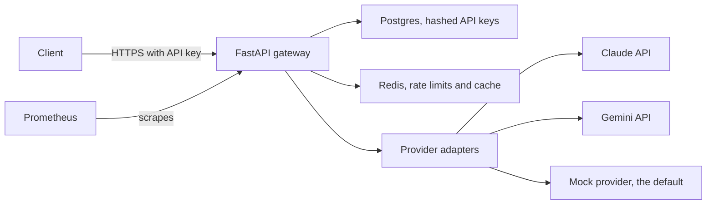
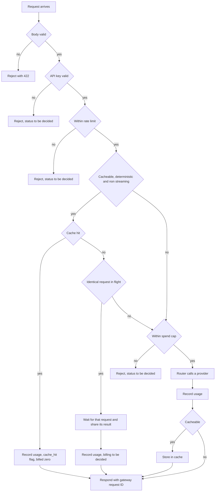
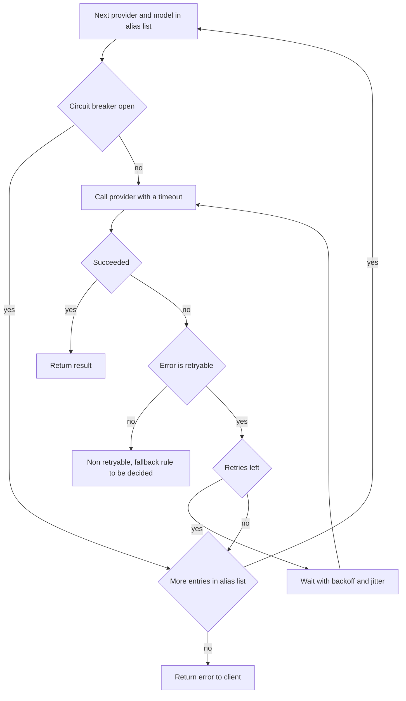
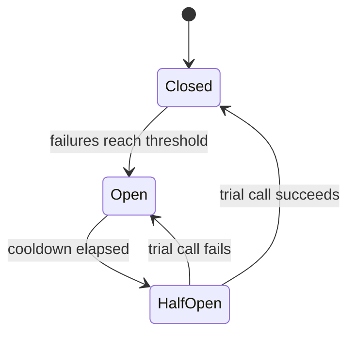
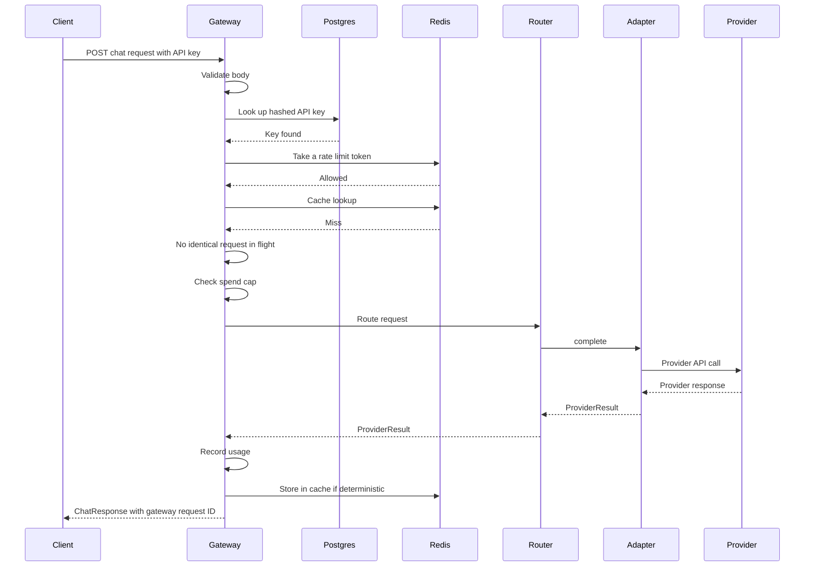

# FLOW.md

## 1. About this file

**Last updated:** 2026-10-22
**Status table reflects commit:** `81c1a8d` (branch `step-5b-fixup`)

How a request moves through LLMGateway, in plain English.

**Honesty rule:** the diagrams show the **target design**. The status table says what **exists**. If this file and [PROGRESS.md](PROGRESS.md) disagree, PROGRESS.md wins.

## 2. Status

A component is **Built** only when its code is on `main` and the five checks in [CLAUDE.md](CLAUDE.md) pass (`uv sync`, `uv run pytest`, `uv run ruff check`, `uv run ruff format --check`, `uv run mypy`). At `81c1a8d` all five pass (114 tests).

| Component | Status | Evidence |
| --- | --- | --- |
| Unified schema | Built | `src/llmgateway/schema.py`, `tests/test_schema.py` (D-006 to D-009, D-013) |
| Provider errors | Built | `src/llmgateway/providers/base.py`; exercised by the failure-injection tests in `tests/test_mock_provider.py`, which are drafts awaiting owner review (D-014) |
| Adapter interface | Built | `src/llmgateway/providers/base.py`; `test_mock_satisfies_adapter_protocol` in `tests/test_mock_provider.py`, checked by mypy (D-015) |
| Mock provider | Built | `src/llmgateway/providers/mock.py`, `tests/test_mock_provider.py` (D-001, D-016). Not yet ticked in PROGRESS.md |
| FastAPI endpoint | Built | `src/llmgateway/app.py`, `src/llmgateway/errors.py`, `src/llmgateway/main.py`, `tests/test_app.py` (D-019, D-022 to D-027). Provider failure tests are drafts awaiting owner review |
| Response IDs | Built | `new_request_id` and the request middleware in `src/llmgateway/app.py`; `provider_response_id` in `schema.py`; `tests/test_app.py` (D-011, D-020) |
| Auth: hashed API keys | Planned | none yet |
| Rate limiter | Planned | none yet (D-002) |
| Cache | Planned | none yet (D-003, D-012) |
| Coalescing | Planned | none yet |
| Spend caps | Planned | none yet |
| Router: timeouts, retries, circuit breaker, fallback | Planned | none yet (D-010) |
| Claude adapter | Planned | none yet |
| Gemini adapter | Planned | none yet |
| SSE streaming | Planned | none yet. Stream event models exist in `schema.py`, but nothing produces or sends them |
| Cost accounting | Planned | none yet (D-012) |
| Prometheus metrics | Planned | none yet |
| Docker Compose | Planned | none yet |
| CI | Planned | none yet |
| Load tests | Planned | none yet |

## 3. Big picture

Target design. The client talks only to the gateway. The gateway talks to the providers only through adapters.



Coalescing, spend caps and Prometheus metrics are stretch goals (D-031).

Where spend caps, coalescing state, and usage records live is not decided yet (see section 9).

## 4. Order of checks per request

Decided in D-018. Body validation is built (422, D-019); the rest is not.



Why each check sits where it does:

1. **Validate the body first.** It is the cheapest check and needs no database or Redis call. A malformed request should not cost a key lookup. Rejected with 422 (D-019).
2. **API key next.** Every later check is per key (rate limit, cache key, spend cap), so the gateway must know who is calling before it can apply them.
3. **Rate limit before any expensive work.** A caller over its limit should be turned away before the gateway does a cache lookup or calls a provider. Whether cache hits also count against the limit is an open question (section 11). PLAN.md measurement 5 expects 429 for this case, and D-019 reserves 429 for the gateway's own rate limiter.
4. **Cache lookup before calling anyone.** Only cacheable requests are looked up; the rest go straight to the spend cap. A hit made no upstream call, so it is returned at once and billed zero (D-012). The cache key includes the caller, so one tenant never sees another tenant's response (D-003).
5. **Coalescing after a cache miss.** If an identical request is already on its way to a provider, this one waits for that result instead of making a second upstream call. PLAN.md measurement 6 targets exactly one upstream call for N identical requests. The coalescing key is the cache key, including the caller, so tenants never share an in-flight result. Only cacheable requests coalesce.
6. **Spend cap just before spending.** This is the last point where the gateway can refuse before money is spent. Placing it after the cache and coalescing means free answers are never blocked by the cap. The rejection status is to be decided. Checking the cap before the call and recording usage after it is not atomic: concurrent requests can all pass the check before any of them records its cost. How the cap stays atomic across a provider call (for example, reserving the worst-case cost before the call and settling the real cost after) is not decided.
7. **Router.** Applies timeouts, retries, the circuit breaker, and fallback (section 5).
8. **Record usage after the call.** Real token counts are only known once the provider answers.
9. **Store in cache only if deterministic and non-streaming** (D-003). Sampled output should not be replayed as if it were the only answer.
10. **Respond with the gateway request ID** (D-011), so logs, metrics, and accounting share one key.

## 5. Router flow (target design)

The router tries the entries of the requested alias in order (D-010). Errors are classified by their `retryable` flag (D-014). Retry counts, timeouts, and backoff values are not chosen yet.



**Streaming rule:** a streaming request can only fall back **before the first byte is sent** to the client. After that, the client has already received part of one provider's answer, and switching providers would splice two different answers together. A failure mid-stream ends the stream with an error instead.

## 6. Circuit breaker (target design)

A circuit breaker stops the gateway from repeatedly calling a provider that is failing. Thresholds, the cooldown time, which errors count as failures, and what one breaker covers are not chosen yet.



- **Closed:** the normal state. Calls go through, and failures are counted.
- **Open:** the provider is treated as down. Calls are not sent; the router moves straight to the next entry in the alias list. This protects a struggling provider and saves the time a doomed call would take.
- **HalfOpen:** after the cooldown, a trial call is let through. If it succeeds, the breaker closes again. If it fails, the breaker opens again and the cooldown restarts.

## 7. One request, step by step (target design)

A non-streaming request that misses the cache and succeeds on the first provider.



## 8. Module map

What exists under `src/llmgateway` at `81c1a8d`, plus planned modules. Planned names may change.

```
src/llmgateway/
├── __init__.py          Built: package docstring only
├── schema.py            Built: ChatRequest, ChatResponse, Usage, stream event models
├── providers/
│   ├── __init__.py      Built: package docstring only
│   ├── base.py          Built: ProviderResult, ProviderAdapter, ProviderError classes
│   ├── mock.py          Built: MockProvider
│   ├── claude.py        planned, name may change
│   └── gemini.py        planned, name may change
├── app.py               Built: create_app, request middleware, endpoints
├── errors.py            Built: error body, status mapping, exception handlers
├── main.py              Built: module-level app for uvicorn
├── auth                 planned, name may change: API key hashing and lookup
├── ratelimit            planned, name may change: Redis Lua token bucket
├── cache                planned, name may change: cache key and storage
├── coalescing           planned, name may change
├── spend                planned, name may change: spend caps
├── router               planned, name may change: timeouts, retries, breaker, fallback
├── accounting           planned, name may change: usage and cost records
└── metrics              planned, name may change: Prometheus metrics
```

Tests: `tests/test_schema.py`, `tests/test_mock_provider.py`, and `tests/test_app.py` exist.

## 9. What lives where (data)

| Where | What | Status |
| --- | --- | --- |
| Postgres | Hashed API keys, managed with SQLAlchemy and Alembic | Planned |
| Redis | Rate limit token buckets, updated by a Lua script using Redis server time (D-002) | Planned |
| Redis | Cached responses, keyed by a hash of the normalized request, model, params, and caller (D-003) | Planned |
| To be decided | Spend cap counters, usage and cost records, coalescing state | Not decided |
| Never stored | Plaintext API keys: only hashes are kept, compared in constant time | Rule in CLAUDE.md |
| Never logged | Prompts, response content, API keys, secrets | Rule in CLAUDE.md |
| Never in the repo | Secrets of any kind; the repo is public | Rule in CLAUDE.md |

## 10. Glossary

- **Adapter:** a small translator for one provider. It turns the gateway's unified request into that provider's API call, and the provider's answer or error back into the gateway's types. Everything else in the gateway only sees the unified types.
- **Token bucket:** a rate limiting method. Each key has a bucket that refills at a steady rate up to a maximum. Each request takes a token; with no tokens left, the request is turned away. It allows short bursts but caps the average rate.
- **Why Lua:** the rate limiter must read and update a bucket in one step, or two requests at the same moment could both see the last token. Redis runs a Lua script as a single uninterrupted step, so that cannot happen. Using Redis's own clock means every gateway instance agrees on the time (D-002).
- **Cache key, and why it includes the caller:** the cache key is a fingerprint of the request: its normalized content, model, parameters, and the caller's key or tenant ID. Equal requests get the same fingerprint (that is why `stop=[]` is normalized to `None`, D-013). The caller is included so one customer can never receive a response cached for another (D-003).
- **Coalescing:** when several identical requests arrive at the same time, only the first goes to the provider. The others wait and share its answer. This saves money and protects the provider during bursts.
- **Backoff and jitter:** after a failure, wait before retrying, and wait longer after each failure (backoff). Add a small random amount to each wait (jitter), so many clients that failed together do not all retry at the same instant.
- **Circuit breaker:** a switch that stops calling a provider after it keeps failing, then cautiously tries again later. See section 6.
- **Fallback:** if one provider cannot answer, try the next provider and model in the alias's list (D-010). The list is explicit, so the gateway never guesses which models are equivalent.
- **Retryable error:** an error where trying again might work, such as a timeout, a provider rate limit, or a provider outage. A bad request or a credential problem will fail the same way every time, so it is not retryable (D-014).
- **Spend cap:** a budget per API key. Once a key's recorded spend reaches its cap, further paid requests are refused. The check must be atomic so concurrent requests cannot overshoot it; PLAN.md measurement 7 targets zero overshoot.
- **Mock provider:** a fake provider built into the gateway. It answers instantly or with a set delay, fails on demand at a set rate, and gives the same answer every time, so tests are free and repeatable. Its token counts are word counts, not real tokens (D-001, D-016).

## 11. Open design questions

Listed, not answered.

- Which provider and model pairs go into each alias list, and in what order (the mechanism is decided in D-010; the lists are not).
- Whether cache hits count against rate limits.
- The status code returned when a spend cap rejects a request.
- Retry counts, timeouts, and circuit breaker thresholds: to be chosen, then measured.
- Whether the circuit breaker counts provider rate limits as failures (D-014).
- How coalesced requests are billed.
- How spend caps stay atomic across a provider call.
- Whether the API key is checked before the request body is parsed, once auth exists. Parsing first lets unauthenticated callers make the gateway parse large bodies (D-018, D-025).

## 12. Keeping this file honest

- Update the status table in the same PR that merges a component, never before.
- Do not edit the target-design diagrams to match code that does not exist.
- When a decision changes the flow, link its D-number in the affected section.
