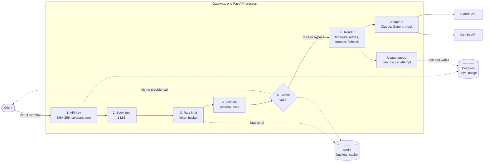
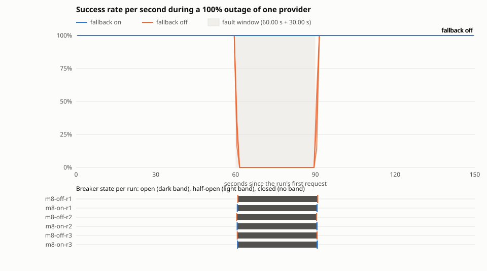

# LLMGateway

A FastAPI service in front of the Claude and Gemini APIs that adds authentication, rate limits, a response cache, timeouts, retries, a circuit breaker, provider fallback and per-attempt cost accounting, behind one request and response format.

**Why.** An application that calls LLM providers directly has to handle each provider's API, keys, rate limits, outages, retries and spend on its own. A gateway does that once, in one place. This one is a personal systems project, built to learn and to measure that reliability layer; it is not a product.

## How a request flows



The checks run cheapest first, and each one protects the next: a bad key is refused before the body is read, an oversized body before it costs a rate-limit token, and a limited request before it is parsed. The router tries the alias's providers in order. A stream can still move to the next provider until its first event reaches the client; after that it is committed. [FLOW.md](FLOW.md) is the full spec, and [docs/USAGE.md](docs/USAGE.md) walks through each step and every setting.

## Key results

Measured with k6 against mock providers on one laptop ([conditions](docs/RESULTS.md#conditions)):

- **Through a [30 s full outage](docs/RESULTS.md#m8-outage) of one provider, [100%](docs/RESULTS.md#m8-window) of requests were served with fallback on, and [0%](docs/RESULTS.md#m8-window) with it off**, in all three runs of each, at 50 req/s.
- **The gateway adds [2.0 ms at p95](docs/RESULTS.md#m1-overhead)** (2.02 ms, range 1.81 to 2.11 over three runs) over the same mock called directly.



With fallback off, the requests that arrived in the first 0.2 s of the outage got 502, and the breaker then refused the rest with 503 without calling the provider. With fallback on, every request in the window was served by the second provider.

## Quickstart

Needs Docker with Compose v2. Nothing else: the default config uses the built-in mock provider, so no provider key is needed and nothing is billed.

```bash
git clone https://github.com/Jasmeet-011/LLMGateway.git
cd LLMGateway
docker compose up --build --wait
KEY=$(docker compose exec -T api python -m llmgateway.keys create --tenant demo)
```

`up --wait` builds the image, starts Postgres and Redis, runs the database migrations, and returns when the gateway is healthy on `127.0.0.1:8000`. The key is printed once; Postgres keeps only its SHA-256.

A normal request (`mock` is a model alias that the default config maps to the mock provider):

```bash
curl -s http://127.0.0.1:8000/v1/chat \
  -H "Authorization: Bearer $KEY" -H "Content-Type: application/json" \
  -d '{"model": "mock", "max_tokens": 32, "messages": [{"role": "user", "content": "hello there"}]}'
```

The same request, streamed as server-sent events (`delta` events, then one `end` event with the usage):

```bash
curl -sN http://127.0.0.1:8000/v1/chat \
  -H "Authorization: Bearer $KEY" -H "Content-Type: application/json" \
  -d '{"model": "mock", "max_tokens": 32, "stream": true, "messages": [{"role": "user", "content": "hello there"}]}'
```

`docker compose down -v` stops everything and deletes the database volume.

<details>
<summary>The same in PowerShell 7.3 or later</summary>

```powershell
git clone https://github.com/Jasmeet-011/LLMGateway.git
cd LLMGateway
docker compose up --build --wait
$KEY = docker compose exec -T api python -m llmgateway.keys create --tenant demo
curl.exe -s http://127.0.0.1:8000/v1/chat -H "Authorization: Bearer $KEY" -H "Content-Type: application/json" -d '{"model": "mock", "max_tokens": 32, "messages": [{"role": "user", "content": "hello there"}]}'
curl.exe -sN http://127.0.0.1:8000/v1/chat -H "Authorization: Bearer $KEY" -H "Content-Type: application/json" -d '{"model": "mock", "max_tokens": 32, "stream": true, "messages": [{"role": "user", "content": "hello there"}]}'
docker compose down -v
```

</details>

To call the real Claude and Gemini APIs (which costs money), to use the cache, or to inject failures, see [docs/USAGE.md](docs/USAGE.md).

## Features

- **One API for both providers.** Clients send a model alias; a TOML config maps it to an ordered list of provider models ([D-010](docs/decisions/D-010.md), [D-044](docs/decisions/D-044.md)).
- **Adapters over raw httpx**, not the provider SDKs, so the only retries are the router's ([D-032](docs/decisions/D-032.md)).
- **Normalized SSE streaming:** one event shape for Claude, Gemini and the mock, and an explicit `error` event when a stream fails partway ([D-068](docs/decisions/D-068.md), [D-069](docs/decisions/D-069.md), [D-073](docs/decisions/D-073.md)).
- **API keys hashed in Postgres**, checked before the body is read, with one identical 401 for every kind of bad key ([D-086](docs/decisions/D-086.md) to [D-089](docs/decisions/D-089.md)).
- **Request body limit** of 1 MiB, enforced on chunked bodies too ([D-108](docs/decisions/D-108.md)).
- **Per-key token-bucket rate limit** in one Redis Lua script that reads Redis's clock, so every worker shares one exact limit ([D-103](docs/decisions/D-103.md), [D-104](docs/decisions/D-104.md)).
- **Tenant-scoped response cache** in Redis, opt-in per request ([D-110](docs/decisions/D-110.md), [D-111](docs/decisions/D-111.md)).
- **Timeouts and retries:** up to 3 attempts per provider with full-jitter backoff, 60 s per attempt and 90 s per request ([D-050](docs/decisions/D-050.md)).
- **Circuit breaker** per provider instance: 15 failures in the last 20 outcomes open it (rate limits and bad requests do not count) for 30 s, then one probe ([D-055](docs/decisions/D-055.md), [D-057](docs/decisions/D-057.md)).
- **Provider fallback** on anything but a bad request, with 30 s of the deadline kept for the next provider ([D-060](docs/decisions/D-060.md), [D-061](docs/decisions/D-061.md)).
- **Usage and cost:** one Postgres row per provider attempt, retries and failures included, with cost in integer nano-dollars, written off the response path ([D-095](docs/decisions/D-095.md), [D-096](docs/decisions/D-096.md), [D-099](docs/decisions/D-099.md)).
- **Fault injection** for mock providers only, including a timed outage window ([D-064](docs/decisions/D-064.md)).

## Design decisions

Every decision, with the alternatives it beat and its risks, has its own file in [docs/decisions/](docs/decisions/), indexed in [DECISIONS.md](DECISIONS.md). Five of them:

- **No retry after the provider answered 2xx** ([D-052](docs/decisions/D-052.md)). If a provider returns 200 with a body the gateway cannot parse, the answer was generated and billed, so a retry would pay for it twice. The router does not retry it; it may still fall back to the next provider, so at most one more answer is paid for per provider in the list.
- **SHA-256 for API keys, not bcrypt** ([D-087](docs/decisions/D-087.md)). A key's secret is 256 random bits, so no offline guess can find it under any hash. A slow hash protects low-entropy passwords; here it would only add CPU to every request and give unauthenticated callers a cheap way to load the gateway. A key is found by its public id and compared in constant time, with a dummy compare for unknown ids ([D-088](docs/decisions/D-088.md)).
- **The rate limiter fails open when Redis is down; auth fails closed when Postgres is down** ([D-106](docs/decisions/D-106.md)). Auth decides whether anyone may spend; the limiter only paces keys that are already verified and billed. A Redis that is slow rather than down is treated differently: a rate-limit check with no answer in 1 s is refused with 503, and the limiter's own breaker counts a timeout only if no other check succeeded meanwhile, which tells a Redis outage apart from an overloaded gateway.
- **The cache is opt-in** ([D-111](docs/decisions/D-111.md)). No request field can promise a repeatable answer: Claude's current API rejects `temperature`, and newer Gemini models ignore it. So a client asks for a cached answer with `x-gateway-cache: use`, and a temperature above 0 is never cached. The tenant is inside the hashed key, so one tenant never gets another's answer, and a fast hit never tells one tenant what another asked ([D-110](docs/decisions/D-110.md)).
- **The outage measurement was fixed before it ran** ([D-121](docs/decisions/D-121.md), [D-123](docs/decisions/D-123.md)). Every run, its command and how it is aggregated were pushed before the first run; each figure is the median of three runs with the range, and a run is repeated only for a recorded defect. The headline cites the full-outage test, not the 30%-failure test, because retries have no switch: the 30% test's "fallback off" baseline already retried, so it showed fallback adding only 2.8 points.

## Testing

- **Test-first.** From milestone M7 on, a separate tester agent wrote each milestone's tests from the spec, not from the code. From M9 on, each milestone's tests were run and seen failing before any implementation was written.
- **Mutation-checked.** From M7 on (and for the earlier error-mapping tests), every failure-path test was checked by breaking the code it guards on purpose and confirming the test fails.
- **No real provider calls in the default run.** Unit tests use fakes, `httpx.MockTransport` and the mock provider. Tests that call the real Claude and Gemini APIs are marked `live` and run only by the owner.
- **Integration tests on real Postgres and Redis.** They run against the Compose stack: the rate-limit script on the real Redis, exactly the allowed number passing under concurrency, tenant isolation in the cache, and Postgres and Redis outages ([D-081](docs/decisions/D-081.md)).
- **CI.** GitHub Actions runs `uv sync --locked`, ruff, ruff format, mypy (strict) and pytest, then builds the Compose stack and runs the integration tests, on every push to `main` ([D-080](docs/decisions/D-080.md)).

Locally, `.\scripts\check.ps1` runs the same five checks (PowerShell). [docs/USAGE.md](docs/USAGE.md#tests-and-ci) shows how to run the integration tests.

## Load testing

k6 drove the gateway with auth, the body limit, the rate limiter (its Redis script runs on every request), the router and accounting all on, and the providers replaced by mocks; requests opted into the cache only in the cache test. Everything ran in one Docker VM on one laptop, one gateway worker. Each figure is the median of three runs, [minimum to maximum]:

| Measurement | Result |
| --- | --- |
| Gateway overhead over the same mock called directly, 50 req/s | p50 1.07 ms [0.93 to 1.10], p95 2.02 ms [1.81 to 2.11] |
| Throughput, one worker, 50 concurrent clients | 509.3 req/s [489.1 to 537.0], no errors |
| Cache, 80% repeated prompts | hit p50 2.81 ms [2.23 to 2.94] vs miss p50 24.92 ms [23.78 to 25.43] |
| 30% injected provider failures, 50 req/s | 97.20% [96.87 to 97.40] successful with fallback off (retries on), 100.00% with fallback on |
| One provider fully down for 30 s, 50 req/s | inside the outage, 0.00% successful with fallback off and 100.00% with fallback on; the breaker opened 0.2 s in |
| Burst of 100 against a 20-request bucket | exactly 20 served and 80 refused with 429 and `Retry-After`, in 3 of 3 runs |

[docs/RESULTS.md](docs/RESULTS.md) has the machine, the exact commands, every run's numbers, the raw output and the code that turns it into these tables. In every failure run, the usage rows in Postgres were counted against the gateway's own log and k6's results, and every count matched.

## Known limitations

The full list is in [docs/RESULTS.md](docs/RESULTS.md#known-limitations). In short:

- **Mocks on one laptop.** The numbers describe the gateway's own cost and behavior, not Claude's or Gemini's latency or reliability.
- **Injected failures are fast and clean.** Real outages are often slow timeouts, which would change both success rates and latency.
- **One worker.** Breakers and fault windows are per process, so the tests ran one uvicorn process; more workers would raise throughput but split them.
- **The second provider was always healthy** in the fallback tests, which is the best case for fallback.
- **Spend caps, request coalescing and metrics are not built**; they were stretch goals ([D-031](docs/decisions/D-031.md)).

## How this was built

Built with [Claude Code](https://claude.com/claude-code) under a test-first workflow with independent tester and reviewer agents: the rules are in [CLAUDE.md](CLAUDE.md), and the agents' briefs in [.claude/agents/](.claude/agents/). The tester writes tests from the spec and runs the mutation checks; the reviewer reads each finished milestone and returns PASS or FAIL. I set the plan and its milestones ([PLAN.md](PLAN.md)), approved every decision in [DECISIONS.md](DECISIONS.md), and ran the tests against the real Claude and Gemini APIs myself.

## Project layout

```
src/llmgateway/
  app.py, main.py             FastAPI app, middleware order, startup
  schema.py, errors.py        request and response models, error mapping
  config.py                   alias config and settings
  auth.py, keystore.py, keys.py           API keys: hashing, lookup, CLI
  bodylimit.py                request body limit
  ratelimit.py, ratelimit.lua, redisguard.py   token bucket in Redis
  cache.py                    response cache
  router.py, breaker.py       retries, deadlines, circuit breaker, fallback
  streaming.py                SSE responses and client disconnects
  providers/                  Claude, Gemini and mock adapters; SSE decoder
  usage.py, usagestore.py, prices.py, prices.toml   usage and cost
  migrations/                 Alembic migrations
config/                       alias configs: mock pair, real providers, load test
tests/                        unit, integration and live tests
loadtest/                     k6 scripts, run script, report generator
docs/                         RESULTS.md, raw load-test output, USAGE.md
docs/decisions/               one file per design decision
scripts/check.ps1             the five checks
PLAN.md, DECISIONS.md, FLOW.md   scope, decision index, request-flow spec
```

## License

[MIT](LICENSE).
