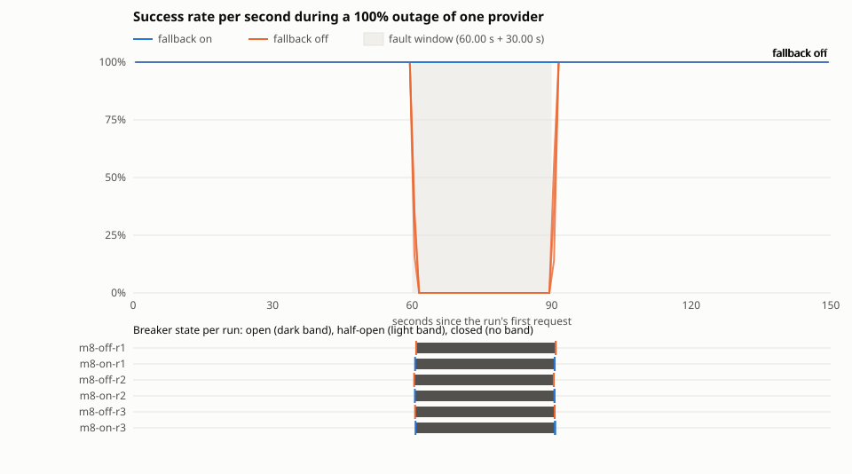

# RESULTS.md

Load-test results for LLMGateway (M18). Every number here comes from a measured run whose raw output is committed under [results/raw/](results/raw/), and is computed by `uv run python loadtest/report.py`, which writes [results/tables.md](results/tables.md), [results/summary.json](results/summary.json) and the outage chart. The measurements are fixed by PLAN.md's Measurements table; the runs, their order and how they are aggregated were fixed in this file and pushed before the first run (D-121).

**Status: measured (2026-11-13).** The first pass ran from 20:31 to 21:33 UTC. The laptop went into Modern Standby during it (a defect, recorded under Results), so 27 of its 30 runs were rerun from 22:08 to 22:54 UTC with the machine awake. Both passes are reported. The conditions and commands below were written before any measured run. Results are added below them after the runs; nothing above the Results heading is changed by the results except to record a defect.

Everything here is measured against the **mock provider on one laptop**. No real provider is called. These numbers describe the gateway's own behaviour and cost, not Claude's or Gemini's latency or reliability.

## Conditions

### Machine

- ASUS ROG Strix G712LV laptop: Intel Core i7-10750H (6 cores, 12 threads, 2.6 GHz base), 16 GB RAM, on AC power with the Windows "Turbo" power scheme.
- Windows 11 Home Single Language 10.0.26300.
- Docker Desktop with the WSL 2 backend: Docker Engine 28.0.4, kernel 6.18.58.1-microsoft-standard-WSL2. The Docker VM sees 12 CPUs and 7.65 GiB of memory (8,215,347,200 bytes). The gateway, Postgres, Redis, the direct mock and k6 all share it.
- Other applications were not closed for the runs beyond what the runs need; the machine was otherwise idle and not used during the runs.

### Stack

- Everything runs in Docker Compose: `compose.yaml` plus [`loadtest/compose.loadtest.yaml`](../loadtest/compose.loadtest.yaml), and for some runs one more override (below). The gateway image is built from this commit's `Dockerfile`: Python 3.12.15, uvicorn 0.54.0 with h11 and the asyncio event loop (no uvloop, no httptools), FastAPI 0.143.1.
- **Gateway worker count: 1.** The image's command runs one uvicorn process. Measurement 8's fault window and the circuit breakers are per process (D-064, D-055), so one worker keeps one window and one breaker per instance (D-119).
- The **providers are mocks inside the gateway's process** (`config/loadtest.toml`, D-119), not separate services:

  | Instance | Latency | Injected failure rate | Failure type | Seed | Used by |
  | --- | --- | --- | --- | --- | --- |
  | `mock-steady` | 20 ms | 0 | - | 3 | alias `steady`: measurements 1, 2, 3, 5 |
  | `mock-primary` | 20 ms | 30% | `unavailable` (retryable) | 1 | aliases `failures-off`, `failures-on`: measurement 4 |
  | `mock-secondary` | 40 ms | 0 | - | 2 | second entry of `failures-on` and `outage-on` |
  | `mock-outage` | 20 ms | 0, and 100% from 60 s to 90 s after its first call | `unavailable` | 4 | aliases `outage-off`, `outage-on`: measurement 8 |

  A failed mock call waits its latency too (D-016).
- **The direct mock** (measurement 1's baseline, D-120): [`loadtest/direct_mock.py`](../loadtest/direct_mock.py), the same `MockProvider` at 20 ms, served by the same uvicorn, one worker, from the same image, as the Compose service `direct-mock`. It reads and discards the body and answers one fixed request.
- **Rate limiter:** every API key's bucket is `LLMGATEWAY_RATE_LIMIT_BURST=100000`, `LLMGATEWAY_RATE_LIMIT_PER_SECOND=100000`, far above any rate here, so **the limiter runs its Redis script on every request but never refuses one** and does not shape the results. Measurement 5 alone uses a burst of 20 and a refill of 1 per second ([`loadtest/compose.burst.yaml`](../loadtest/compose.burst.yaml)).
- **Cache:** **requests do not opt into the cache**, except in measurement 3, so the cache makes no Redis call and every 200 says `x-gateway-cache: bypass`. In measurement 3 every measured request opts in, and each run's prompts carry the run id, so the cache is cold when each run starts.
- **Key cache:** the default 10 s (D-090), except the `m1-nokeycache` runs, which set 0 ([`loadtest/compose.nokeycache.yaml`](../loadtest/compose.nokeycache.yaml)) so every request also reads its key from Postgres.
- **Retries, timeouts and the breaker** are the shipped code defaults in every run (they have no switch, D-050): up to 3 attempts per entry with full-jitter backoff from 0.2 s up to 2 s, a 60 s per-attempt and 90 s total deadline, 30 s kept for the next entry; a breaker per instance that opens at 15 failures in the last 20 outcomes, stays open 30 s, and then lets one probe through (D-050, D-057, D-061).
- **Per run:** `api` and `direct-mock` are recreated (a fresh process with closed breakers, the mock's seeded sequence from its start, and an empty key cache); Postgres and Redis keep running. Each gateway run makes its own API key, whose tenant is the run id, so its rate-limit bucket, cache entries and usage rows are its own.
- Every request is non-streaming.

### Load generator

- k6 **v2.3.0** (`k6 version`: commit e088784614, go1.27.1, linux/amd64), image `grafana/k6:2.3.0@sha256:2dd4756ec6e14e62778916e1eb850108e4b499304c02df56760fa0bdb0fba0b8` (the multi-platform index; pushed to Docker Hub on 2026-10-24, inside the 7-day floor, D-118). It runs as the `k6` Compose service on the same Docker network and reaches the gateway at `http://api:8000` and the direct mock at `http://direct-mock:8000`, so no request crosses the Windows host's port forwarding.
- Scripts: [`loadtest/k6/`](../loadtest/k6/). Each logs one line per request (scenario, start time, status, duration, whether the body was a success, the cache header, the serving instance, `Retry-After`).

### Definitions (D-120)

- **Successful response:** HTTP 200 whose body is JSON with a string `content`. A 4xx or 5xx, a body that does not parse, a connection error, or k6's 120 s timeout is not a success.
- **Success rate:** successful responses divided by the requests k6 sent in the measured scenario. Requests k6 could not start on time (`dropped_iterations`) are reported next to it.
- **Latency:** k6's `res.timings.duration` for one request (sending, waiting and receiving, without connection setup; k6 keeps connections alive), over successful responses only. Percentiles are nearest-rank: p95 is a latency some request actually had, the smallest one that at least 95% of requests did not exceed.
- **Gateway overhead (measurement 1):** for each repetition, a percentile of the gateway run minus the same percentile of the direct-mock run made just before it. Both pay the same 20 ms mock sleep, the same uvicorn, the same network and the same k6, so the difference is what the gateway itself adds: auth, the body size check, the rate limiter's Redis round trip, parsing and validating the body, routing, queuing the usage record, logging and building the response. The 20 ms is removed by this subtraction, not by subtracting 20 ms. It is a difference of two percentiles, not a percentile of per-request differences. The reported figure is the median of the three repetitions, with their minimum and maximum.
- **Measurement 4's A and B:** A is the success rate with **fallback off** (alias `failures-off`: only `mock-primary`, 30% of its attempts fail). B is the **same load with everything on** (alias `failures-on`: `mock-primary`, then `mock-secondary`). **In both, retries, timeouts and the circuit breaker are on**, because they are code defaults with no switch (D-050). So B − A is what fallback adds on top of retries, not what the whole reliability layer adds over a bare call; no bare-call baseline is run. `mock-secondary` injects no failures, so B describes one provider failing while the other is healthy. X = 30% (each attempt on `mock-primary`), N = 50 req/s.
- **Throughput (measurement 2):** successful responses in the 60 s measured scenario, divided by 60.
- **Hit rate (measurement 3):** responses with `x-gateway-cache: hit` divided by the measured scenario's requests.
- **Aggregation:** each measurement runs three times; the figure is the **median of the three, with the minimum and maximum**, never the best run. Every run's own numbers are listed.

### Runs and their exact commands (D-121)

Setup, once, from the repository root in PowerShell:

```powershell
docker compose -f compose.yaml -f loadtest/compose.loadtest.yaml up --build -d --wait
docker pull grafana/k6:2.3.0@sha256:2dd4756ec6e14e62778916e1eb850108e4b499304c02df56760fa0bdb0fba0b8
```

Then each run, in this order, one at a time, is exactly `.\loadtest\run.ps1 -Run <id>`. [`loadtest/run.ps1`](../loadtest/run.ps1) reads the run's settings from [`loadtest/runs.json`](../loadtest/runs.json), recreates `api` and `direct-mock` with the run's Compose files, makes the key, runs k6 and saves `docs/results/raw/<id>/`. The k6 command it runs is `k6 run -q --log-format json --console-output /out/<id>/records.jsonl --summary-export /out/<id>/summary.json /scripts/<script>` in the `k6` service, with `TARGET`, `ALIAS`, `RUN_ID`, `MEASUREMENT` and the key in its environment; `run.json` in each run's folder records the exact arguments.

| # | Run id | Measurement | Script | Target, alias | Extra Compose file | Load |
| --- | --- | --- | --- | --- | --- | --- |
| 1 | `m1-direct-r1` | 1 | `steady.js` | direct mock | - | warm-up 10 req/s for 10 s, then 50 req/s for 60 s |
| 2 | `m1-gateway-r1` | 1 | `steady.js` | gateway, `steady` | - | same |
| 3 | `m1-nokeycache-r1` | 1 | `steady.js` | gateway, `steady` | `compose.nokeycache.yaml` | same |
| 4 to 6 | `m1-direct-r2`, `m1-gateway-r2`, `m1-nokeycache-r2` | 1 | as above | | | |
| 7 to 9 | `m1-direct-r3`, `m1-gateway-r3`, `m1-nokeycache-r3` | 1 | as above | | | |
| 10 to 12 | `m2-r1`, `m2-r2`, `m2-r3` | 2 | `throughput.js` | gateway, `steady` | - | warm-up 5 virtual users for 10 s, then 50 virtual users in a closed loop for 60 s |
| 13 to 15 | `m3-r1`, `m3-r2`, `m3-r3` | 3 | `cache.js` | gateway, `steady` | - | warm-up 10 req/s for 10 s without opt-in, then 50 req/s for 60 s, opted in, workload `hot10-repeat80` |
| 16 | `m4-off-r1` | 4 | `failures.js` | gateway, `failures-off` (A) | - | 50 req/s for 60 s, no warm-up |
| 17 | `m4-on-r1` | 4 | `failures.js` | gateway, `failures-on` (B) | - | same |
| 18 to 21 | `m4-off-r2`, `m4-on-r2`, `m4-off-r3`, `m4-on-r3` | 4 | as above | | | |
| 22 to 24 | `m5-r1`, `m5-r2`, `m5-r3` | 5 | `burst.js` | gateway, `steady` | `compose.burst.yaml` | 100 requests at once from 100 virtual users; then from 40 s, 0.5 req/s for 20 s |
| 25 | `m8-off-r1` | 8 | `failures.js` | gateway, `outage-off` | `compose.outage.yaml` | 50 req/s for 150 s, no warm-up; `mock-outage` fails 100% from 60 s to 90 s |
| 26 | `m8-on-r1` | 8 | `failures.js` | gateway, `outage-on` | `compose.outage.yaml` | same |
| 27 to 30 | `m8-off-r2`, `m8-on-r2`, `m8-off-r3`, `m8-on-r3` | 8 | as above | | | |

Workload `hot10-repeat80` (measurement 3): measured request *i* (from 0) sends a unique prompt when *i* mod 5 = 0, and otherwise hot prompt *k* mod 10 with *k* = *i* − floor(*i*/5) − 1, so 80% of requests repeat one of ten prompts that take turns.

Measurement 5 is correct when, in the burst, the 200s are at most 20 plus one per second the burst lasted, every other response is 429 with `Retry-After`, and in the paced phase every response is 200.

**Measurements 6 and 7 are not run:** they need request coalescing and spend caps, which are stretch and not built (D-031).

**Reruns:** a run is repeated only when a defect in the tooling or the stack is found and logged in PROGRESS.md's mistakes log; the rerun is `.\loadtest\run.ps1 -Run <id> -Rerun <k>` and is saved as `<id>-rerun<k>`. The first run stays here, marked with the defect. A run is never repeated because its numbers look wrong.

**Smoke runs:** before the measured runs, short `-Smoke` runs (2 virtual users for 5 s, saved as `smoke-*`) checked that the scripts and the runner work. They are listed at the end; no figure comes from them.

**Accounting cross-check:** after every measurement 4 and 8 run, the runner saves the run's usage rows from Postgres per outcome and instance (one parameterized query). The report checks that the `success` rows equal the gateway's 200s and k6's successes, the `failed` rows equal the gateway's `attempt_failed` lines, and there are no `abandoned` rows (one row per adapter attempt, D-095).

## Results

### First pass (2026-11-13, 20:31 to 21:33 UTC, commit 65b043a)

All 30 runs of the catalog ran once, in catalog order, from a script that called `.\loadtest\run.ps1 -Run <id>` for each id and would have stopped at the first failure. None failed: k6 exited 0 in all 30, and every run's output is committed under [results/raw/](results/raw/).

**Defect: the laptop went into Modern Standby during the batch.** Windows' System log has Kernel-Power event 506, "The system is entering Modern Standby", at 20:36:01 UTC, and no exit event (507) after it through 21:36, when the builder checked. The batch was unattended, and the builder had not kept the machine awake (Agent Mistakes Log in PROGRESS.md). The conditions above describe an awake machine; from 20:36:01 they did not hold.

- m1-direct-r1, m1-gateway-r1 and m1-nokeycache-r1 (20:31:01 to 20:35:16) ran awake.
- m1-direct-r2 (from 20:35:16) was hit mid-run: standby began 36 s after its start, and from that second the direct mock stopped answering in time. Response times rose to 29 s, 23 requests failed with "connection reset by peer", and k6 dropped 1,212 iterations.
- The other 26 runs ran wholly in standby.

The figures of these 27 runs are reported with the rest, but they were not measured in the pre-registered conditions. They are rerun as `<id>-rerun1` with the machine awake, under D-121's rule for a recorded defect.

### Reruns (2026-11-13, 22:08 to 22:54 UTC, commit 11b53af)

The 27 runs from m1-direct-r2 to m8-on-r3 ran once more, in catalog order, each as `.\loadtest\run.ps1 -Run <id> -Rerun 1`. The machine was awake: it left standby at 21:57:35 UTC (Kernel-Power 507). The gateway image was the first pass's (`sha256:2279219a4354746f9b61d516bfeb77fb0bd36afa1fa89ff97dfc514edf388498`, built from 65b043a); the commits since then change only the load-test tooling, tests and docs, none of `src/`, `config/` or the `Dockerfile`. The runner's standby guard (D-121, amended) was in place: every rerun's `run.json` has `"power_events": []`, and k6 exited 0 in all 27.

**Correction to the pre-registered commands (found in the M18 review):** the k6 command under "Runs and their exact commands" leaves out `--no-usage-report`, which `run.ps1` passes in every run, smoke and measured alike (each run's `run.json` lists it under `k6_args`). The flag only stops k6 from sending anonymous usage statistics and does not change what is measured. The pre-registered text is left as it was pushed.

The figures that count are in [results/tables.md](results/tables.md): the three repetition-1 runs of measurement 1 from the first pass, and the reruns for everything else. Every first-pass figure, including those of the 27 replaced runs, is in [results/tables-first-pass.md](results/tables-first-pass.md). The JSON behind each is [results/summary.json](results/summary.json) and [results/summary-first-pass.json](results/summary-first-pass.json).

### Figures

Median of three runs, [minimum to maximum]. "Row" names where the number is in tables.md.

| # | What | Figure | Row in tables.md |
| --- | --- | --- | --- |
| 1 | <a id="m1-overhead"></a>Gateway overhead, key cache 10 s (as shipped) | p50 **1.07 ms** [0.93 to 1.10], p95 **2.02 ms** [1.81 to 2.11], p99 **2.71 ms** [2.27 to 2.74] | Measurement 1, overhead, "gateway, key cache 10 s" |
| 1 | Gateway overhead, key cache 0 (every request reads its key from Postgres) | p50 1.65 ms [1.51 to 1.78], p95 3.07 ms [2.60 to 3.29], p99 4.47 ms [3.09 to 4.48] | Measurement 1, overhead, "gateway, key cache 0" |
| 2 | Throughput, 50 virtual users in a closed loop, one worker | **509.3 req/s** [489.1 to 537.0], no errors; p50 latency 81.77 to 88.65 ms | Measurement 2, "median [min to max]" |
| 3 | Hit rate, workload hot10-repeat80 at 50 req/s | **79.64%** in all three runs (2,390 hits of 3,001) | Measurement 3, "median [min to max]" |
| 3 | Hit and miss latency | p50: hit 2.81 ms [2.23 to 2.94], miss 24.92 ms [23.78 to 25.43]; p95: hit 4.96 ms [3.26 to 5.30], miss 27.83 ms [25.47 to 27.93] (medians of the three rows) | Measurement 3, the three runs |
| 4 | Success rate, 30% injected failures, 50 req/s: **A, fallback off** | **97.20%** [96.87 to 97.40] | Measurement 4, "Fallback off" |
| 4 | **B, everything on** | **100.00%** [100.00 to 100.00] (3,001, 3,000 and 3,001 of as many requests) | Measurement 4, "Fallback on" |
| 5 | 429 under a burst of 100 (burst 20, refill 1/s) | **Correct in 3 of 3:** 20 × 200 and 80 × 429, every 429 with `Retry-After`, nothing else; the paced requests afterwards all 200 (11, 11, 10) | Measurement 5 |
| 8 | <a id="m8-outage"></a>Outage of `mock-outage` from 60 s to 90 s, 50 req/s, whole 150 s run | fallback off **79.84%** [79.84 to 79.85], fallback on **100.00%** [100.00 to 100.00] | Measurement 8, the two summary lines |
| 8 | <a id="m8-window"></a>Inside the window (seconds 60 to 89) | fallback off 0.00% in all three, fallback on 100.00% in all three | Measurement 8, "In window" |
| 8 | Breaker | opened at 60.2 s in all six runs; half-open and closed again at 90.2 to 90.3 s | Measurement 8, "Breaker changes" |

Measurement 8's timeline, generated by `loadtest/report.py` from the raw records and the gateway's breaker log lines:



The first pass's chart, from the runs made in standby, is [results/m8-outage-first-pass.svg](results/m8-outage-first-pass.svg).

### Accounting cross-check (measurements 4 and 8)

After each run of measurements 4 and 8, the usage rows in Postgres for the run's tenant were counted with one parameterized query (D-122) and compared with the gateway's log and k6's records. **All 12 counted runs match**, and so do the 12 of the first pass. In each: usage `success` rows = the gateway's 200 lines = k6's successes; usage `failed` rows = the gateway's `attempt_failed` lines; no `abandoned` rows. For example, m4-on-r1-rerun1 has 3,001 success rows and 1,255 failed rows: 4,256 adapter attempts for 3,001 requests, one row each (D-095). No mismatch was found. The check counts rows; it does not compare token counts, which the mock makes up (D-016).

### What the numbers say, and what caused them

- **B is only 2.8 points above A in measurement 4, because A already retries.** Retries have no switch (D-050), so A is "retries and breaker on, fallback off", not a bare call. With up to 3 attempts at an independent 30% failure rate, a request fails only when all three attempts do: 0.3³ = 2.7%, so A should be about 97.3%; it measured 97.20%. Fallback rescues exactly those: 78 to 83 requests per run were served by `mock-secondary`, about 2.7% of 3,000. B reaching 100% depends on `mock-secondary` being healthy. No breaker opened, since 30% failures stay below 15 of the last 20.
- **Measurement 8 is where fallback matters.** When the primary is fully down, the fallback-off runs answer nothing for 30 s. Ten or eleven requests that arrived before the breaker opened (0.2 s into the window) got 502, and the 1,501 after it got 503 without a provider call. The fallback-on runs answered every request, 1,510 to 1,513 of them from `mock-secondary`.
- **One worker saturates near 500 req/s.** In measurement 2, 50 virtual users kept about 509 requests per second going, with a p50 of about 88 ms against a 20 ms mock, so requests were queueing in the one process. That is about ten times the 50 req/s of measurements 1, 3, 4 and 8, so those ran well below saturation, as D-121 intended.
- **The gateway adds about 1 ms at p50 and 2 ms at p95** over the same mock served directly. Reading the key from Postgres on every request (key cache 0) adds about 0.6 ms more at p50 and 1 ms more at p95.
- **Cache hits skip the provider call**, so a hit's p50 is about 22 ms below a miss's. The hit rate is set by the workload: 601 unique prompts plus the first sight of each of the 10 hot prompts are the 611 misses. It shows that the cache behaves as designed on that workload, not what hit rate real traffic would see.

### The first pass beside the reruns

From [results/tables-first-pass.md](results/tables-first-pass.md); 27 of these 30 runs ran in Modern Standby:

- Measurement 2's throughput was 116.2 req/s [113.2 to 117.4], under a quarter of the 509.3 measured awake. That is the clearest sign that standby changed the numbers rather than adding noise.
- Measurement 1's p95 overhead was 1.81 ms [−24,076.63 to 26.93]: the median is repetition 1, which ran awake. Repetition 2's direct-mock run stalled when standby began, so its difference is hugely negative, and repetition 3's is 26.93 ms.
- Measurement 4: A 97.27% [97.10 to 97.30], B 100.00% [99.53 to 100.00]. B's low end is m4-on-r3, whose first second had 14 `503 auth_unavailable`: the key lookup in Postgres exceeded its 2 s limit (D-091), and auth fails closed.
- Measurement 8: fallback off 79.81% [79.63 to 79.81], fallback on 100.00% [100.00 to 100.00].
- Measurement 5 was correct in 3 of 3, and measurement 3's hit rate was 79.64% in all three.
- Every accounting cross-check matched.

## Known limitations

- **One laptop, mocks only.** Every number is from one Windows laptop (above) running the gateway, Postgres, Redis, the mocks and k6 in one Docker VM, so k6's own CPU use is inside the latencies and the throughput. No real provider was called; the mocks answer in a fixed 20 ms (40 ms for the secondary), so these numbers say nothing about Claude's or Gemini's latency or reliability.
- **Injected failures are fast and clean.** A mock failure is a `ProviderUnavailable` raised after the mock's latency. Real outages often look like timeouts or slow errors, which cost each attempt far more time and would change both the success rates and the latency under failure.
- **One worker, plain asyncio and h11.** Measurement 2 is one uvicorn process without uvloop or httptools (the shipped image, D-119). More workers would raise throughput but split the fault window and the breakers per process.
- **Measurement 4's A includes retries** (no switch, D-050), so B − A is fallback's contribution on top of retries, not the whole layer's over a bare call. **The secondary is healthy in every run**, so B = 100% is the best case for fallback.
- **Modest load and few runs.** 50 req/s in measurements 1, 3, 4 and 8; three runs per figure give a range, not a confidence interval.
- **Measurement 1's overhead is a difference of percentiles** of two separate runs, not a per-request difference. It comes from runs without failures; overhead under measurement 4's failure load was not measured.
- **The cache workload is synthetic** (hot10-repeat80), and its hit rate follows from its definition.
- **Measurements 6 and 7 were not run**: request coalescing and spend caps are stretch and not built (D-031).
- **27 of the first pass's 30 runs ran in Modern Standby.** They are kept and shown, and rerun with the machine awake (D-121, amended).
- **From earlier milestones:**
  - On a thinking model, Gemini bills thinking as output and `max_tokens` does not bound it (D-049). One live run at `MINIMAL` produced no thinking on a short prompt; a harder prompt may still think.
  - A stream cut short before the provider reports usage records an estimated output token count in its own column, never in the counts or the cost (D-101). The estimate's characters-per-token rates overestimated English prose by 13.7% (Claude) and 18.7% (Gemini), in one sample each.

## Smoke runs (not results)

Each is `.\loadtest\run.ps1 -Run <id> -Smoke`: 2 virtual users for 5 s, which replaces the script's scenarios (k6 warns that "cli level configuration overrode scenarios configuration entirely"), so these runs exercise the request, the record, the key, the logs and the usage query, not the measured load. Every attempt is listed, including the ones that failed, in the order they were made on 2026-11-13 (UTC).

| # | Attempt | Outcome | Output |
| --- | --- | --- | --- |
| 1 | `-Run m1-gateway-r1 -Smoke`, about 20:04 | Failed before k6: the runner called `docker -f ...` without `compose` (exit 125). Fixed in the runner. | none was written (it stopped before making its folder) |
| 2 | `-Run m1-gateway-r1 -Smoke`, `smoke-m1-gateway-r1-200440` | Failed: k6 exit 2. Docker Compose 2.34 panics on `run -e` for a service with no `environment` map. Fixed by giving the `k6` service a default `TARGET`. | **Deleted by the builder before the retry**, so not in the repo: it held `api.log`, an empty `k6.txt` and `run.json`, and no records. That deletion broke the rule that every run's output is kept (PROGRESS.md mistakes log). |
| - | Two hand-run `docker compose run ... k6 run ...` commands, to read the panic | Same panic, before any container started | none |
| 3 | `smoke-m1-gateway-r1-200534` | Passed | [raw](results/raw/smoke-m1-gateway-r1-200534/) |
| 4 | `smoke-m1-direct-r1-200627` | Passed | [raw](results/raw/smoke-m1-direct-r1-200627/) |
| 5 | `smoke-m1-nokeycache-r1-200646` | Passed | [raw](results/raw/smoke-m1-nokeycache-r1-200646/) |
| 6 | `smoke-m2-r1-200707` | Passed | [raw](results/raw/smoke-m2-r1-200707/) |
| 7 | `smoke-m3-r1-200727` | Passed (under the smoke override the scenario is `default`, so the script does not opt in and every 200 says `bypass`) | [raw](results/raw/smoke-m3-r1-200727/) |
| 8 | `smoke-m4-off-r1-200748` | Passed; accounting cross-check matched: 124 success and 55 failed rows, 124 200s and 55 `attempt_failed` lines | [raw](results/raw/smoke-m4-off-r1-200748/) |
| 9 | `smoke-m4-on-r1-200809` | Passed; cross-check matched: 109 success and 50 failed rows, 109 200s, 50 failed attempts | [raw](results/raw/smoke-m4-on-r1-200809/) |
| 10 | `smoke-m5-r1-200830` | Passed | [raw](results/raw/smoke-m5-r1-200830/) |
| 11 | `smoke-m8-on-r1-200850` | Passed; cross-check matched (402 success rows) | [raw](results/raw/smoke-m8-on-r1-200850/) |
| 12 | `smoke-m1-gateway-r1-202010` | Passed; a second m1 smoke after the runner began saving k6's stderr in `k6.txt` | [raw](results/raw/smoke-m1-gateway-r1-202010/) |

Smoke runs 3 to 11 saved `k6.txt` without k6's stderr; from 12 on it is included (D-122, amended).
